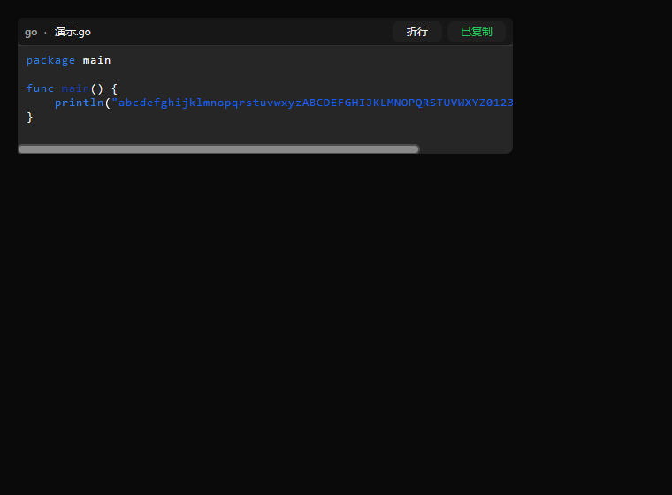
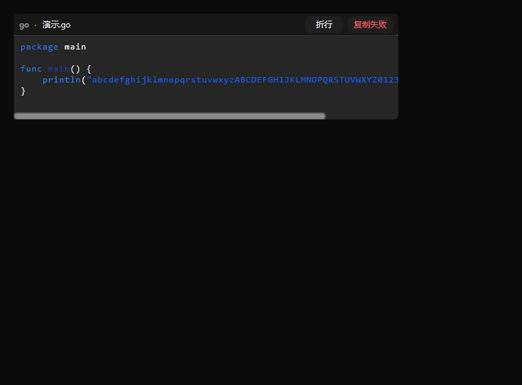
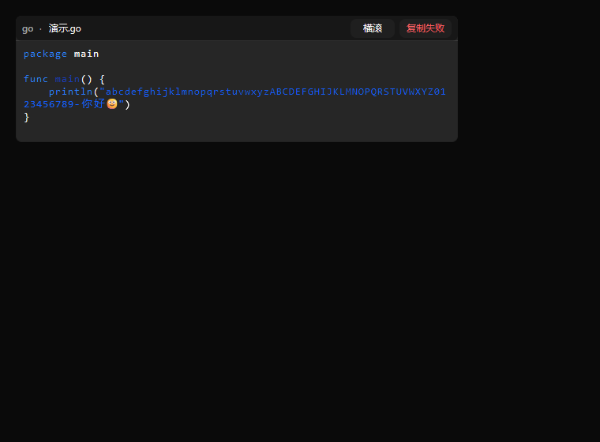

# WP-B1：代码块与链接交互组件验收记录

> 日期：2026-11-04。Owner：WP-B1。指定基线 `9a155c7` + 当前工作树；开工时 HEAD 为 `1a7cf4d`，记录时为 `456a56f`，两次均确认 `9a155c7` 是祖先。HEAD 前进来自其他 owner，本包没有 commit/push。
>
> 修改边界：只改 `internal/mdlite/**`，并新建本文。没有改 `dsconversation`、`cmd/app`、`pluginapi` 或其他包，没有重复实现 MDSTREAM 的流式 Markdown 入口，没有启动应用/服务或杀死进程。

## 1. 交付结果

已完成三个可复用入口：

| 组件 | 真实行为 | 位置 |
|---|---|---|
| `CodeBlock` | 语言/title banner、原字节复制回调、成功/失败文字反馈、wrap toggle、真实横向视口/滚动条、横向滚轮、状态保存恢复、Unicode 与空代码实画；沿用现有 `Highlight` | [codeblock.go:109](../internal/mdlite/codeblock.go#L109)、[codeblock.go:219](../internal/mdlite/codeblock.go#L219) |
| `Link` | 按文字宽度声明 `RoleLink` + hand cursor 命中区，边界外不命中；HTTP(S) 与显式 file 目的地原样回调 | [link.go:31](../internal/mdlite/link.go#L31)、[link.go:64](../internal/mdlite/link.go#L64) |
| `MarkdownLinkActions` | 给现有 `components.MarkdownView` 传非零 `Links` scope，并把 fragment 点击映射到对应 destination；不接管文档解析或流式入口 | [link.go:96](../internal/mdlite/link.go#L96)、[link.go:105](../internal/mdlite/link.go#L105) |

辅助接口：

- `NewCodeBlock` / `ParseCodeFenceInfo`：从 Viva fenced block 保留 `block.Text`，支持 `go,title=main.go`、`python title="统计 分析.py"`，见 [codeblock.go:125](../internal/mdlite/codeblock.go#L125)。
- `State` / `Restore`：保存并恢复 `Wrap` 与 `OffsetX`，见 [codeblock.go:177](../internal/mdlite/codeblock.go#L177)。
- `HandleScroll`：只消费本代码块视口的横向手势或 Shift+纵向滚轮，不抢普通消息纵向滚动，见 [codeblock.go:200](../internal/mdlite/codeblock.go#L200)。
- `Overflow.DrawInteractive`：在旧 `Draw` 兼容保留的同时增加真实 viewport ID，见 [overflow.go:55](../internal/mdlite/overflow.go#L55)。
- `NewFileLink`：文件语义由调用方显式给出；`internal/mdlite/highlight.go#L14-L75` 这类目的地（含行号片段）原样进入回调，见 [link.go:38](../internal/mdlite/link.go#L38)。

**动作边界**：复制与打开均在 `AfterPaint` 中执行调用方注入的回调。生产代码不 import `os/exec`，不访问剪贴板，不执行 OS，不解析宿主根目录，也不把未知字符串猜成文件路径。Viva parser 自身只生成 HTTP(S)/mailto 节点；file 链接由调用方从可信节点显式创建 `Link`/`NewFileLink`，组件不擅自把普通相对路径升级为可打开文件。

## 2. 先红证据（旧实现）

先提交测试到工作树、再写实现。旧实现只有 `Highlight` 与 `Overflow`，运行：

```bash
CGO_ENABLED=0 go test ./internal/mdlite -count=1
```

结果：**exit 1（预期失败）**，证明测试不是对既有行为补写绿灯：

```text
internal\mdlite\codeblock_visual_test.go:18:11: undefined: CodeBlock
internal\mdlite\codeblock_visual_test.go:19:11: undefined: CodeBlockIDs
internal\mdlite\codeblock_visual_test.go:20:11: undefined: CodeBlockStyle
internal\mdlite\link_visual_test.go:18:13: undefined: Link
internal\mdlite\link_visual_test.go:21:13: undefined: MarkdownLinkActions
internal\mdlite\codeblock_test.go:29:10: undefined: NewCodeBlock
internal\mdlite\codeblock_test.go:45:22: undefined: ParseCodeFenceInfo
```

实现后曾出现一次测试断言错误：把软折行的视觉行边界当成原始换行比较，exit 1；随后把断言改为“去掉视觉行边界后所有字节仍按原顺序出现”，没有把产品代码改成向复制文本插入换行。

## 3. 行为覆盖矩阵

| 验收点 | 实际断言 |
|---|---|
| fenced 多语言 | 解析 Go、Python、text 三个围栏；分别断言语言、`main.go`/`统计.py` title 与代码正文；另有 TypeScript info 解析用例 |
| 空代码 | 高度仍大于 banner，复制目标仍存在，实画不 panic |
| 长行不硬切 | 非 wrap 模式断言 `MaxOffsetX > 0`、完整长行仍在绘制命令中；wrap 模式断言视觉行增加、无横向溢出、每个代码字节按原顺序保留 |
| Unicode | 同一长行包含中文与 emoji；另有 CRLF、tab、中文和末尾换行的复制用例 |
| 逐字节复制 | Go string 相等比较原始字节；回调收到完整的 `package main\r\n…\t…你好🙂…\r\n`，不是 banner 文本、软折行文本或 TrimSpace 结果 |
| 成功/失败反馈 | 无头点击真实 `复制代码` hit；成功实画 `已复制` 且状态为 `CopySucceeded`，注入 error 后实画 `复制失败` 且状态为 `CopyFailed` |
| wrap/横滚 | 真实 `session.Scroll` 后 `OffsetX > 0` 且代码 X 坐标左移；点击 `切换折行` 后视觉行增加、横向溢出归零；切回及新实例 `Restore` 均恢复状态 |
| HTTP/file 链接 | 直接 HTTP、显式 file（含 `#L14-L75`）、现有 MarkdownView HTTP 三种路径均实画、点击并收到精确 destination/kind 回调 |
| 区域边界 | 每条链接断言左内缘可命中，左/右/上/下四侧外点均不命中且不执行回调；共 3 条 × 4 个外侧点击 |
| Highlight/流式不回退 | 代码块 `TextRun` 使用现有关键字高亮色；原高亮测试全部通过；另跑 `plugins/dsconversation` 全部测试通过 |

## 4. 命令与退出码

以下命令均在仓库根目录执行，Go 为 `go1.27.3`：

| 命令 | 退出码 | 结果 |
|---|---:|---|
| `CGO_ENABLED=0 go test ./internal/mdlite -count=1` | **0** | `ok github.com/MYCF711/dsh-ui/internal/mdlite`；含全部旧 Highlight 测试与新增组件/无头测试 |
| `CGO_ENABLED=0 go vet ./internal/mdlite` | **0** | 无输出 |
| `outdir=$(mktemp -d); CGO_ENABLED=0 go build -o "$outdir/app.exe" ./cmd/app` | **0** | app 构建成功；二进制写 OS 临时目录，没有污染仓库或启动程序 |
| `CGO_ENABLED=0 go test ./plugins/dsconversation -count=1` | **0** | 现有流式 Markdown 测试通过 |
| `git diff --check -- internal/mdlite` | **0** | 无空白错误 |
| `CGO_ENABLED=0 go vet ./...` | **1（非本包并发问题）** | 两次均为 `plugins/dsstatusbar/metrics_test.go:16:10: undefined: sessionStats`；本包边界不允许修改，已通知 Lead 协调该 owner |

最终无头实画/命中与截图命令：

```bash
export MDLITE_CAPTURE_DIR="D:/DeepSeek Harness/default-workspace/dsh-ui/internal/mdlite/testdata/codeblock-actions"
CGO_ENABLED=0 go test ./internal/mdlite \
  -run 'Test(CodeBlockHeadlessCopyFeedbackWrapScrollAndScreenshots|LinksHeadlessRealRegionsCallbacksAndBoundaries)$' \
  -count=1 -v
```

结果：**exit 0**。两个测试均 PASS；不是只调用布局纯函数，而是 Viva `headless.Session` 的真实 Paint、`HitTest`、Click、Scroll、AfterPaint 与 PNG renderer。

## 5. 截图证据

### 5.1 复制成功：banner、完整原文回调后的可见反馈、横滚条



- 760×560，15,535 bytes。
- SHA-256：`0dc771c64368eaed74f982a4ed0a9bebeb0a04eab8d56b2a56b6391e9fff4c5c`。

### 5.2 注入复制失败后的可见反馈



- 760×560，15,815 bytes。
- SHA-256：`bf64a2240cf545df959ed504c31842421e2f166882573b1c3e483ba5cf6428ce`。

### 5.3 wrap toggle 后长行与 Unicode 完整实画



- 760×560，17,553 bytes。
- SHA-256：`92f07357fb5cbb72536c7659a2f53f218b6255faba48a93d1db03734bc7d7e3b`。

### 5.4 HTTP、file 与 MarkdownView 链接实画（命中由上述测试断言）


- 760×320，8,325 bytes。
- SHA-256：`cf2a700ea38cb9a4eba9cffd624f2b44ddf9d27ea7e40a3aebc9ea1e31171311`。

## 6. 未验项与后续接线

1. **没有验证真实 OS 剪贴板或打开文件/浏览器**：这是组件的刻意边界，已验证的是调用方回调收到精确数据及成功/失败反馈。OS 能力与宿主授权由后续整合 owner 注入，不能拿本组件测试冒充宿主闭环。
2. **没有接入消息区**：按派单未改 `dsconversation`；消息级复制动作行、消息时间、Turn footer 属 WP-C，不在本包。
3. **file 链接不做自动文本探测**：可信文件节点由调用方显式创建组件；普通 Markdown 字符串不会被猜成宿主路径。
4. **截图是 scale=1 的无头真实像素**，不是人工可见 OS 窗口；命中、回调、原文比较都有独立自动断言，截图没有被用来替代这些断言。
5. **全仓 vet 仍受上述 `dsstatusbar` 并发测试编译错误影响**；WP-B1 指定的 mdlite 测试、包级 vet 和 app build 已分别为 exit 0。
