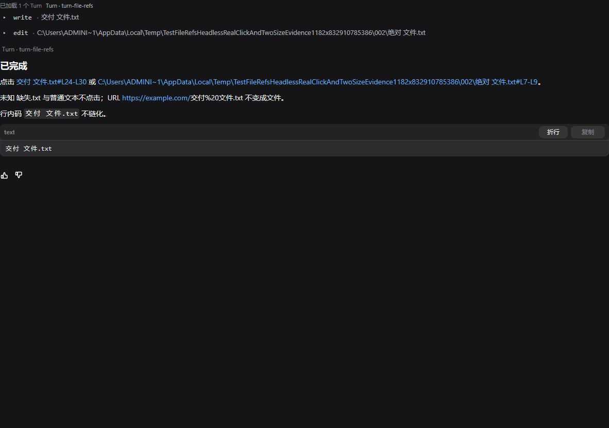
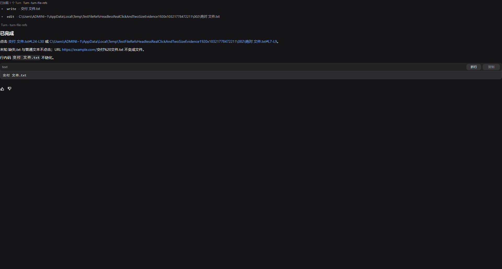

# FILE-REFS：deliverables 第 4 项 clickable final-response file references

> 日期：2026-11-04。Owner：FILE-REFS。施工目录：`C:\Users\Administrator\AppData\Local\Temp\dsh-ui-file-refs-isolated`。
>
> 基线：**`aeadda97af5ef408573052c637940ebc72f40328`（`aeadda9`）+ 当前共享导出**，其中已含 WP-C1/C2/C3、WP-D1、STATS-WIRE。未改宿主、其他插件、Transport/插件共享契约，未 commit/push，未杀进程。

## 1. 交付行为

- [dsdeliverables.WrittenPaths](../plugins/dsdeliverables/deliverables.go) 导出同一个只读提取入口：只消费 `tool` 角色中 `write`/`edit` 的 `filePath`、`file_path`、`path` 明确字符串参数，按首次出现去重并返回新切片。没有从 bash、助手正文、文件系统或新 Transport 字段增加数据源；原有侧栏 `paths` 继续复用同一实现。
- [file_refs.go](../plugins/dsconversation/file_refs.go) 只把上述已知路径在 assistant Markdown 正文中的精确出现改写成真实文件链接。普通文本、未知路径、URL、既有 Markdown 链接、行内码和 fenced code 不会被猜成文件；WP-C1 已支持的显式 `file://` Markdown destination 先由原实现处理并保持原行为。
- 相对路径只使用 `Snapshot.CWD` 解析；CWD 缺失或本身不是绝对路径时不退回进程工作目录、不猜。绝对路径直接清理后使用。Windows 盘符路径、明确的 Git Bash `/c/...` 形式、空格和 Unicode 均进入同一 `net/url` + `filepath` 路径。
- 显示文本保留原路径及 `#L24` / `#L24-L30`。行号只写入链接 fragment 供显示和未来编辑器定位；实际打开仍走既有 `Actions.OpenFile` → `model.openFile` → `filePathFromLink` → `app.OpenPath`，fragment 不进入实际文件路径，没有新增 OS 执行路径。
- [conversation.go](../plugins/dsconversation/conversation.go) 将改写后的正文和 fake URL 背后的真实目的地映射共同纳入 Markdown 缓存键。同正文、宽度、CWD 和已知路径继续复用 `Document/MarkdownView`；CWD 改变不会误开旧工作区。MDSTREAM 流式与定稿仍使用相同下标和缓存对象。

未替换 WP-C1 HTTP/file 链接、复制与代码块、WP-C2 Turn/滚动/后台缓存、WP-C3 工具状态、dstool/dsbrand、审批原 `requestId/optionId`；WP-D1 与 STATS-WIRE 共享文件也未改。

## 2. 先红证据

实现前新增行为测试并运行：

```bash
CGO_ENABLED=0 go test ./plugins/dsconversation -run 'FileRefs' -count=1 -v
CGO_ENABLED=0 go test ./cmd/app -run '^TestFileRefsHeadlessRealClickAndTwoSizeEvidence$' -count=1 -v
```

旧实现两条命令均 **exit 1（预期）**：

- [old-red-plugin.log](../cmd/app/testdata/file-refs/old-red-plugin.log)：已知相对/绝对路径的文件映射为 0；缺 CWD 用例也没有得到应有的绝对路径链接。普通字符串、未知路径、URL、行内码和 fenced code 排除用例当时已经通过。
- [old-red-headless.log](../cmd/app/testdata/file-refs/old-red-headless.log)：1182×832 与 1920×1032 都报 `headless: no control labelled "交付 文件.txt#L24-L30"`，即已知路径没有可点击控件。

实现后同一组断言转绿。后续只修正测试支架：用可选择全文核对跨绘制 run 的长路径、为 headless `OpenPath` 创建真实点击目标、对长绝对路径点击包含文件名和行号的可见末段；另补 CWD 缓存回归，未放宽文件路径或排除项断言。

## 3. 最终命令与退出码

基线施工前已运行全仓 `CGO_ENABLED=0 go test ./...` 与 `CGO_ENABLED=0 go vet ./...`，均 **exit 0**，见 [baseline-full-test.log](../cmd/app/testdata/file-refs/baseline-full-test.log) 与 [baseline-full-vet.log](../cmd/app/testdata/file-refs/baseline-full-vet.log)。

最终代码的命令均在上述隔离目录执行：

| 命令 | 退出码 | 证据 |
|---|---:|---|
| `CGO_ENABLED=0 go test ./plugins/dsdeliverables ./plugins/dsconversation ./cmd/app -count=1 -v` | **0** | [related-test.log](../cmd/app/testdata/file-refs/related-test.log)；含 WP-C1/C2/C3、MDSTREAM、FILE-REFS 与壳动作回归 |
| `CGO_ENABLED=0 go vet ./plugins/dsdeliverables ./plugins/dsconversation ./cmd/app` | **0** | [related-vet.log](../cmd/app/testdata/file-refs/related-vet.log) |
| `CGO_ENABLED=0 go test ./... -count=1` | **0** | [full-test.log](../cmd/app/testdata/file-refs/full-test.log) |
| `CGO_ENABLED=0 go vet ./...` | **0** | [full-vet.log](../cmd/app/testdata/file-refs/full-vet.log) |
| `GOCACHE=C:/Users/Administrator/AppData/Local/Temp/file-refs-gocache CGO_ENABLED=0 go build ./...` | **0** | [full-build.log](../cmd/app/testdata/file-refs/full-build.log) |
| `gofmt -l plugins/dsdeliverables plugins/dsconversation cmd/app` | **0** | 无输出 |
| 以施工前共享导出临时 index 为基准的 `git diff --check -- plugins/dsdeliverables plugins/dsconversation cmd/app docs/file-refs.md` | **0** | 无空白错误 |

单测实际覆盖：已知相对路径可链化且按 CWD 得到绝对目的地；绝对路径不依赖 CWD；未知路径与普通字符串不链化；缺 CWD 不猜相对路径；`#L` 片段保留在显示/URL fragment 而不进入文件路径；URL、行内码和 fenced code 不获得文件语义；同帧缓存不重复排版且 CWD 变化更新真实目的地。

## 4. 两尺寸真实点击与截图

复现命令：

```bash
export FILEREFS_CAPTURE_DIR="C:/Users/Administrator/AppData/Local/Temp/dsh-ui-file-refs-isolated/cmd/app/testdata/file-refs"
CGO_ENABLED=0 go test ./cmd/app \
  -run '^TestFileRefsHeadlessRealClickAndTwoSizeEvidence$' -count=3 -v
```

结果：**exit 0**，两个尺寸连续三轮均 PASS，完整输出见 [headless-green.log](../cmd/app/testdata/file-refs/headless-green.log)。测试走真实 Viva Paint → HitTest → ClickLabel → AfterPaint → `Actions.OpenFile` → headless OS driver 的 `app.OpenPath` 请求，不是直接调用路径解析函数冒充点击。

每个尺寸都断言：

1. `缺失.txt` 没有可点击 Hit；URL、行内码和 fenced code 同时出现在被测画面中，但没有被升级为文件链接。
2. 点击 `交付 文件.txt#L24-L30` 后，`LastOpenedPath` 精确等于 `filepath.Join(Snapshot.CWD, "交付 文件.txt")`，不含 `#L24-L30`。
3. 点击长绝对路径中含 `绝对 文件.txt#L7-L9` 的可见 fragment 后，`LastOpenedPath` 精确等于原绝对路径，不含行号。
4. PNG renderer 实图尺寸与指定窗口一致且文件非空；最终图已重新读取复核，能看到两个已知路径链接、未知路径、URL、行内码和 fenced code 的对应画面。

| 尺寸 | 实图 | bytes | SHA-256 |
|---|---|---:|---|
| 1182×832 |  | 46,935 | `7ecf87eae47e61429573c8b22837b4519700c03baaebcd9fda2a2e260d2f60d6` |
| 1920×1032 |  | 67,822 | `849f0693224d95a543f473723fa8a43e0bc003f2c1bf1189361885b91eb5dab2` |

## 5. 未验项与边界

1. 未启动真实 dshd 做生成→write/edit→最终回复的桌面整链，也未在桌面弹出编辑器。两尺寸证据是 Viva 真实无头绘制、命中和 OS capability 请求；路径正确性另有独立断言，不靠截图推断。
2. `#L24-L30` 已保留用于显示/未来定位，但 `app.OpenPath` 只打开文件，尚未实现编辑器逐行定位。
3. 只认 write/edit 明确参数路径及其在 assistant 文本中的精确出现；不推断 bash 命令、不将 read/glob 结果补成交付物、不检查文件是否在工具调用后仍存在。既有非 `file:` Markdown 链接不嵌套改写，HTTP(S) 仍走原链接语义。
4. 当前实测平台为 Windows；POSIX 路径分支由同一 `filepath` 代码编译覆盖，但没有另起 Linux/macOS 桌面验证。
5. 补丁只含本工作包相对“`aeadda9` + 施工时共享导出”的增量；共享导出中已有的其他未提交改动不由本补丁重复携带。

最终增量补丁：`C:\Users\Administrator\AppData\Local\Temp\file-refs-final.patch`。
