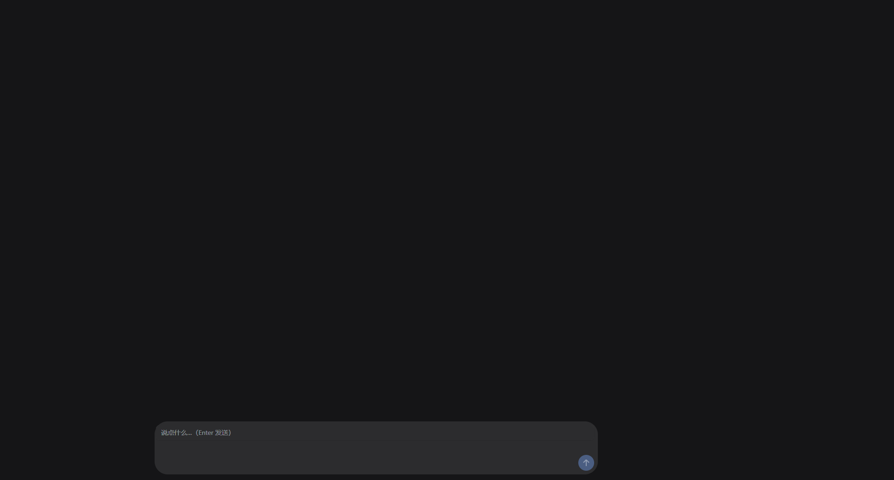
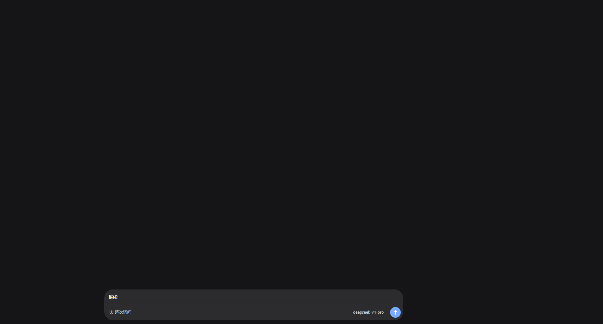
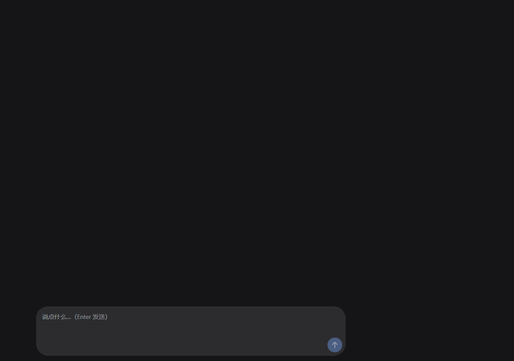
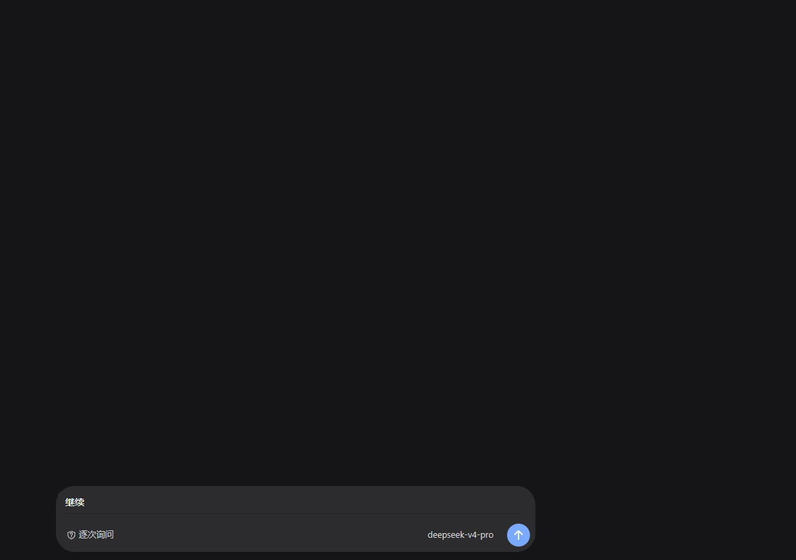
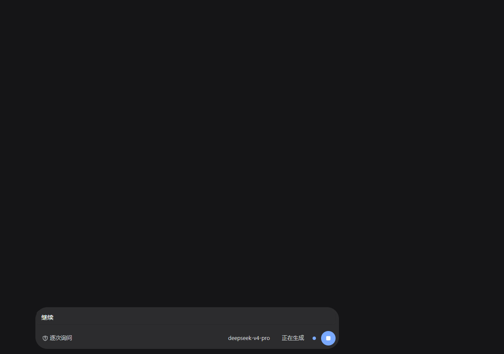

# FG-4 · Composer 控件行验收

日期：2026-11-04  
continuation owner：FG-4（接替失败代理 `26dddd99`）  
隔离目录：`C:/Users/Administrator/AppData/Local/Temp/dsh-ui-fg4-isolated`  
base rev：`2aea9f3c08f2ed466cf3cbc04fb315b6c99d5ecd`（`2aea9f3`）  
施工范围：仅 `plugins/dscomposer/**` 与本文；未改共享契约、其他插件或共享文档，未 commit/push，未杀进程。

## 1. 结论

- `CGO_ENABLED=0 go test ./plugins/dscomposer -count=1`：exit 0。
- `CGO_ENABLED=0 go vet ./plugins/dscomposer`：exit 0。
- `CGO_ENABLED=0 go build ./cmd/app`：exit 0。
- `CGO_ENABLED=0 go build ./cmd/mockd`：exit 0。
- 1920×1032、1182×832 两档的 hero/active 均由真实 Viva headless 窗口光栅化抓图；另抓 1182 stop。卡片宽、高、局部 x 与官方目标的偏差均为 **0px**，不超过 8px；主按钮均为 34×34，右距/底距均为 8px。
- 权限显示中文真值与矢量图标；模型、权限没有目录和 mutation 时保持只读，无 chevron、Expandable 或假点击区；命令/附件无 Action 时不画。
- 发送/停止使用官方 16×16 viewBox 矢量，保留原 `send` / `stop` ID、34px 命中区与 Send/Cancel 行为；审批三个按钮仍分别回传宿主原 `requestId` / `optionId`。

## 2. 原失败原因与文案核对

### 2.1 接手时红灯

接手后首先在原补丁上执行：

```bash
CGO_ENABLED=0 go test ./plugins/dscomposer -count=1
```

结果 **exit 1**，只有两个相关子测试失败：

```text
TestPermissionTruthUsesChineseProductAndPolicyLabels/auto:
permission "auto" 显示为 "自动审查"，want "自动审批"
TestKnownPermissionHasVectorIconBesideLabel/auto:
已知权限 "auto" 应显示中文真值 "自动审批"
```

`hostLabels` 的注释和测试已经约定宿主策略 `auto` 显示“自动审批”，但实现分支仍写“自动审查”，属于实现与既定宿主映射不一致；本次将该分支补为“自动审批”，没有放宽测试。

### 2.2 “自动审批”不是官方原文，不能冒充官方 auto-review

本次没有为了让测试变绿而宣称它是官方文案，核对结果如下：

1. 官方 [`permission-presets/client.js`](../tmp/official/dsh-client-ui-permission-presets/client.js#L189-L227) 的 `accessZh` 在 `auto.label` 明确写 **“自动审查”**；同文件 202–206 行说明它是每次原生工具调用与 PTC 内层调用前，由同一模型执行的实验性审查。
2. 同文件 [`AUTO_REVIEW_PRESET`](../tmp/official/dsh-client-ui-permission-presets/client.js#L229-L303) 的机器值也是 `auto`，并绑定 `PermissionIconAutoReviewRegular`。因此，单看官方 UI，`auto → 自动审查` 才是原文映射；**“自动审批”不是官方 preset 文案**。
3. 但当前宿主 H5 的 `Permission` 明确是进程审批策略 `deny/ask/allow/auto`，不是官方 permission catalog，见 [`DSH-GO/internal/transport/api.go`](../../DSH-GO/internal/transport/api.go#L96-L102)。宿主 [`makeAskFuncWith`](../../DSH-GO/cmd/dshd/main.go#L936-L979) 对 `auto` 的实际行为是：终端或 stdio 审批通道中询问，非终端直接拒绝；它不是“同一模型逐调用审查”。
4. 因而本实现把“自动审批”限定为 **DSH-GO 宿主策略的本地中文标签**，不把该宿主策略冒充官方 auto-review，也不声称这四个字来自官方 locale。`ask=逐次询问`、`deny=全部拒绝` 同样是没有官方 preset 等价物的宿主策略标签；未知非空值保留原文，空白整段隐藏。

官方 preset 的明确产品文案仍逐项采用：`read-only=仅可查看`、`workspace-write=工作区内修改`、`danger-full-access=完全权限`，依据同文件 159–166、189–200 行。`allow` 是宿主审批闸全放行，映射到可读标签“完全权限”，而不是显示裸枚举。

## 3. 官方源码依据与落地

### 3.1 InputBar / sendButton

官方 [`InputBar`](../tmp/official/dsh-client-ui-conversation/client.js#L19120-L19368) 与 [`InputBar CSS`](../tmp/asar-css/039__InputBar.module.css.mjs.css) 给出：

- 卡片 `border:0`、`radius-panel`、顶 padding 8、gap 12；root 两侧 clearance 16。
- 控件行 `padding:2px 8px 6px`，主按钮 34×34、999px 圆角、`button-info-fill`、`translateY(-2px)`。
- 发送路径为 16×16 viewBox 的填充 arrow path；停止为 `x=3 y=3 width=10 height=10 rx=3` 的圆角矩形。
- `onMouseDown=keepDraftFocus`：主按钮动作不应抢编辑器焦点。

落地：[`composer.go`](../plugins/dscomposer/composer.go) 保留 V3 的行高与等效上移几何；[`icons.go`](../plugins/dscomposer/icons.go) 逐点移植发送路径和停止矩形，不再使用字体 `↑` / `■`。按钮使用 `SkipFocus`，空草稿、无 Send、无 Cancel 都有 disabled 真值；发送仍 trim 后只调一次 Send 并清草稿，运行态只调 Cancel。

### 3.2 modelLabel / ModelSelect

官方 [`ModelSelect`](../tmp/official/dsh-client-ui-model-selection/client.js#L1410-L1524) 的 `modelLabel` 来自当前 catalog choice 的 `model.name`，trigger 有菜单 ARIA、chevron 和 `setSelection` 行为；[`ModelSelect CSS`](../tmp/asar-css/059__ModelSelect.module.css.mjs.css) 为 28px 高、13/20/400、`max-width:min(360px,45cqw)`。

当前 `Snapshot.Model` 只有宿主当前模型 ID，没有 catalog、effort 目录或 selection mutation。故只显示该真值，沿用官方 28px、13/20/400 和 360/45% 宽度档；不画 chevron，不注册 Expandable/按钮命中区，也不编“默认模型”。空值不画。

### 3.3 PermissionSelect

官方 [`PermissionSelect`](../tmp/official/dsh-client-ui-permission-presets/client.js#L287-L415) 与 [`PermissionSelect CSS`](../tmp/asar-css/061__PermissionSelect.module.css.mjs.css) 给出 28px 高、max220、13/20/500、14px triggerIcon、4px gap。四个官方 preset 各有对应矢量图标；自定义 host preset 不猜官方图标。

落地：已知宿主 policy/preset 显示中文标签和图标，未知非空 policy 只保留原文、不猜图标。没有 permission catalog/mutation，所以只读、无 chevron/菜单语义。官方只读外观不是完整下拉能力的替代品，未实现项见 §7。

### 3.4 命令、附件与审批

- 官方 InputBar 的 `add` 是 `toggleCommandMenu`，28×28；附件走独立 `conversation.input.attachments` slot。当前 Snapshot/Actions 没有命令目录、附件草稿或上传/移除动作，生产 UI 不画加号、附件按钮或 rail，也没有死命中区。
- V3 几何继续采用 `content=clamp(680,column*.64,920)`、`cardMax=content+32`、hero input 52 / active input 36；对应卡高 114 / 98。
- 审批布局保持 V3 的 Warn 外框、InputMajor 填充、R20、与 composer 18px 净间距。`approval-allow` 回传主 allow 项，`approval-allow-always` 通过 `decideOption` 回传它自己的 option ID，`approval-deny` 回传 reject 项；request ID 原样来自宿主，缺 ID 时不伪造回传。

## 4. 最终命令与退出码

环境：Windows amd64，Go `1.27.3`，`CGO_ENABLED=0`，`GOPROXY=https://goproxy.cn,direct`。

| 命令 | 结果 |
|---|---|
| `CGO_ENABLED=0 go test ./plugins/dscomposer -count=1` | **exit 0**；`ok github.com/MYCF711/dsh-ui/plugins/dscomposer` |
| `CGO_ENABLED=0 go vet ./plugins/dscomposer` | **exit 0**；无输出 |
| `CGO_ENABLED=0 go build ./cmd/app` | **exit 0**；无输出 |
| `CGO_ENABLED=0 go build ./cmd/mockd` | **exit 0**；无输出 |
| `COMPOSER_CAPTURE_DIR='C:/Users/Administrator/AppData/Local/Temp/dsh-ui-fg4-isolated/plugins/dscomposer/testdata/frame-composer' CGO_ENABLED=0 go test ./plugins/dscomposer -run '^TestControlsHeadlessGeometryAndCapture$' -count=1 -v` | **exit 0**；5/5 子测试 PASS，截图非空且尺寸正确 |
| `gofmt -l plugins/dscomposer` | **exit 0**；无输出 |
| `git diff --check` | **exit 0**；无 whitespace 错误 |

截图测试不是只计算布局：每个子测试通过 `headless.Open` 打开真实 Viva frameless session，Pump 后读取 retained primitives 断言几何，再调用 `Screenshot` 和 `Image` 验证实际 PNG 像素尺寸。PNG 只包含本 composer 的真实组件场景，不冒充完整应用或真宿主截图。

## 5. 两尺寸截图、几何与 SHA-256

### 5.1 几何量测

下表 x/y 是组件测试所模拟的中栏内容框坐标；官方约束是卡片宽、高、居中局部 x，而不是把全窗绝对 y 当成 CSS 常量。所有目标差均 ≤8px。

| 场景 | PNG 尺寸 | 官方卡片目标 `x,w,h` | 实测 `x,y,w,h` | 目标偏差 | 主按钮 / 边距 |
|---|---|---|---|---|---|
| 1920 hero | 1920×1032 | `332,952,114` | `332,906,952,114` | x/w/h 各 **0px** | 34×34；right 8 / bottom 8 |
| 1920 active | 1920×1032 | `332,952,98` | `332,922,952,98` | x/w/h 各 **0px** | 34×34；right 8 / bottom 8 |
| 1182 hero | 1182×832 | `83,712,114` | `83,706,712,114` | x/w/h 各 **0px** | 34×34；right 8 / bottom 8 |
| 1182 active | 1182×832 | `83,712,98` | `83,722,712,98` | x/w/h 各 **0px** | 34×34；right 8 / bottom 8 |
| 1182 stop | 1182×832 | `83,712,98` | `83,722,712,98` | x/w/h 各 **0px** | 34×34；right 8 / bottom 8 |

active 场景另断言 permission/model trigger 的真实布局高均为 28px。发送/停止按钮内均有对应主题前景色的矢量三角形，测试禁止回退到字体 `↑` / `■`。

### 5.2 文件与哈希

| 截图 | SHA-256 |
|---|---|
| [`visual-v4-1920-hero.png`](../plugins/dscomposer/testdata/frame-composer/visual-v4-1920-hero.png) | `1c6e992b17dbba2a1984b60e1f3e76d582663c094b659bc08a8bf2748ad42de8` |
| [`visual-v4-1920-active.png`](../plugins/dscomposer/testdata/frame-composer/visual-v4-1920-active.png) | `a2d3fd88031ff4ffa6982a77361a264c0d45128b1827814c754134783426c78b` |
| [`visual-v4-1182-hero.png`](../plugins/dscomposer/testdata/frame-composer/visual-v4-1182-hero.png) | `bdd96a99f0e2f7bac1481ced52fb51d8d6db48b76af3f1b5932ba05589e69643` |
| [`visual-v4-1182-active.png`](../plugins/dscomposer/testdata/frame-composer/visual-v4-1182-active.png) | `51a4b11b86d9c15f45834d9b8bb792d8ba3e54d8e2768a163254563359732f52` |
| [`visual-v4-1182-stop.png`](../plugins/dscomposer/testdata/frame-composer/visual-v4-1182-stop.png) | `f4782cb4e1c89eb23922e6119fd0267cd84ef63a04c83a89bd00ab458c9afe24` |

### 5.3 真实截图

1920 hero：



1920 active：



1182 hero：



1182 active：



1182 stop：



## 6. 行为验收索引

- `TestPermissionTruthUsesChineseProductAndPolicyLabels`：已知中文映射、未知原文、空白隐藏。
- `TestKnownPermissionHasVectorIconBesideLabel`：每个已知权限标签左侧都有真实矢量。
- `TestModelReadOnlyHasNoDropdownSemantics`、`TestComposerUnknownFieldsAndUnsupportedControlsStayHidden`：无假下拉、假命令/附件、假默认真值。
- `TestModelTriggerUsesOfficialWiderMaxWidth`：模型不再被权限 220px 档压住，13/20/400 与 28px 几何保持。
- `TestPrimaryButtonsUseOfficialVectorsAnd34pxHitArea`、`TestPrimaryDisabledTruthAndDraftSafety`：矢量、34px 命中区、原 ID、SkipFocus、disabled 与草稿安全。
- `TestSendButtonPreservesTrimAndClearBehavior`、`TestStopButtonPreservesCancelBehavior`：发送一次/清空与 busy 只停止。
- `TestApprovalButtonsPreserveOriginalIDsThroughLayout`、`TestApproveForwardsOriginalIDs`、`TestWeirdIDsAreNotRewritten`、`TestAllowAlwaysGetsItsOwnButton`：按钮实际事件分支和纯函数均验证原 ID，AllowAlways 不回退成 AllowOnce。
- `TestComposerCardMatchesOfficialGeometry`、`TestApprovalCardMatchesOfficialSurface`、`TestControlsHeadlessGeometryAndCapture`：V3 卡片/审批几何与本轮真实像素证据。

## 7. 未验证 / 未实现项

1. **模型与权限切换未实现**：没有 catalog、effort、SelectModel/SetPermission mutation；未验证菜单、风险确认、失败回滚或选择后的宿主机读回。当前只读 UI 不承诺这些能力。
2. **命令与附件未实现**：无真实 Action，故不画。未验证命令菜单焦点恢复、文件选择、拖放、上传、重试、附件 prompt 或重载。
3. **真宿主 H4/H5 链未在本轮重跑**：中文标签与空值由 Snapshot 级测试验证；本轮 PNG 是组件场景，不声称完成真 dshd 的 model/permission 端到端验收。
4. **真工具执行未在本轮重跑**：审批验证到 `Actions.Approve` 的原 ID 回调；未据此宣称 allow 后真工具已执行、deny 后真工具未执行。
5. **OS 级 IME/多行编辑器未验**：`SkipFocus` 的 Hit 语义有测试，但未做真机中文输入法、长文、多行滚动和 selection 保持验收；当前仍是单行 `flex.Field`。
6. **动画与完整视觉未验**：busy dot 不做官方 1s 明暗动画；V3 已有的阴影/警告色近似未在本轮重新做官方逐像素色彩验收。本报告也不计算整屏相似度。
7. **验收范围是定向包**：按任务运行 dscomposer 测试、vet 与 app/mockd 构建；未以全仓 `go test ./...` 替代其他 owner 的验收。
