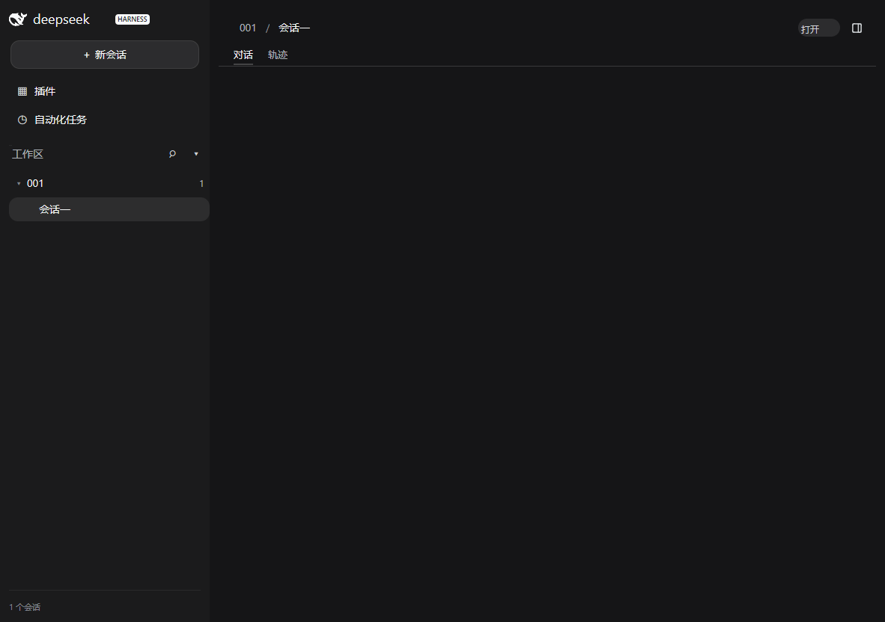
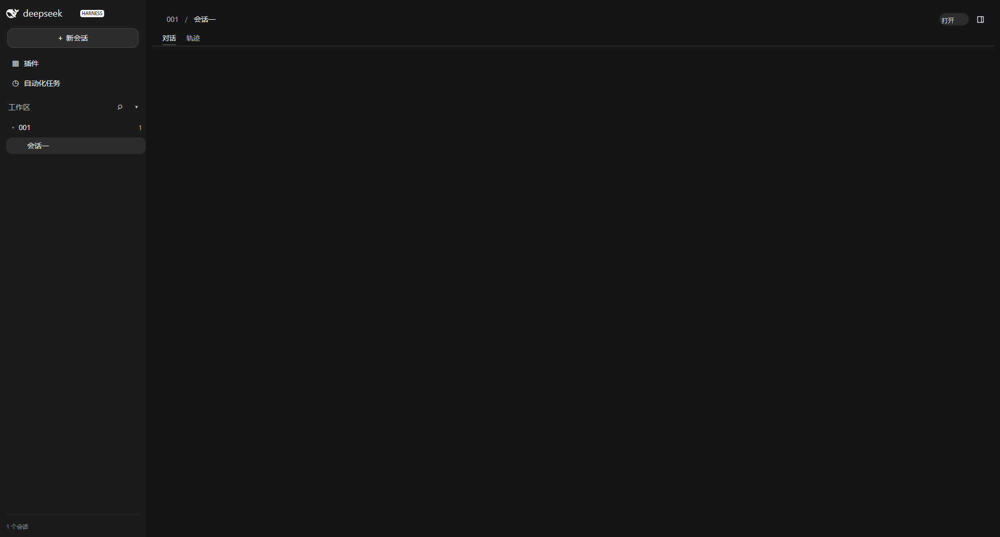

# OPEN-IN-APP：会话头部「在工作目录里打开」

> 日期：2026-11-04。Owner：OPEN-IN-APP（continuation，接替未落盘实现的前 owner）。
>
> 施工目录：`C:\Users\Administrator\AppData\Local\Temp\dsh-ui-open-in-app2-isolated`（最新共享导出）。
>
> 基线 rev：**`b396f3a`**（`b396f3ad9b194a53c5c11b9b0edc3928d7d3fe18`，*接上 session.load 的 reasoning*），导出里已含 FILE-REFS / WP-C3 / WP-D1 / STATS-WIRE 与 reasoning 接线；施工前全仓 `go test ./...`、`go vet ./...` 均 exit 0。
>
> 改动范围：`plugins/dsopen/**`、`cmd/app/**` 与本文。**未改**其他插件、宿主、`pluginapi` 共享契约；未 commit/push；未杀进程；未 `reset`（红测取回旧实现用 `git show HEAD:<file>`，见 §2）。

## 1. 交付行为

| 项 | 行为 |
|---|---|
| 何时画 | `Snapshot.CWD` 是**绝对路径**（`D:\ws`、`d:/ws`、`\\server\share`、`/srv/ws`、`/`）**且** `Actions.OpenFile != nil`。缺 CWD / 相对 CWD（`ws\proj`、`D:ws`、`.\proj`）/ 首尾空白 / 只有 `OpenExternal` / 没有任何动作 → **整颗不画**，不是画成禁用态。 |
| 画在哪 | 中栏会话头部 `titleRow` 里的 `headerUtilities` 位（官方 `headerUtilities{flex:none;gap:8px}`，在 28×28 的 `headerCorner` 左边 8px）。56×24，垂直居中于 30px 标题行。 |
| 怎么不挤压页签 | 用 Viva 的 `Absolute()` 画：**不参与布局流**。页签的矩形在"有按钮/无按钮"两帧里逐像素相同，标题行与正文也不被推走（§5 有断言）。 |
| 点什么 | `Actions.OpenFile("file:///…")`，destination 只由 CWD 造出：`D:\ws\项目` → `file:///D:/ws/%E9%A1%B9%E7%9B%AE`。**不经过** `OpenExternal`。 |
| 怎么打开 | `cmd/app`：`model.openFile` → `filePathFromLink`（只认显式 `file:`）→ `openLocal`：常规文件走 Viva `app.OpenPath`（平台默认程序，driver 运行记录 `LastOpenedPath`）；**目录**走平台文件管理器（`explorer.exe` / `open` / `xdg-open`）。 |
| 失败 | 只写既有状态栏：「打开目录失败: …」/「打开文件失败: …」；成功写「已打开目录」/「已打开文件」。插件不弹窗、不回退到别的动作。 |
| 保留 | FG-3 的 tabs/rightbar、FILE-REFS、WP-C1/C2/C3、审批原 `requestId/optionId` 全部未动；全仓回归见 §4。 |

**为什么必须走 `OpenFile` 而不是 `OpenExternal`（这一条是本次的根因）：**
`Actions.OpenExternal` 的契约是"只打开明确的 http/https/mailto 目的地"，实现是 Viva 的 `app.OpenURL`（`viva@v0.2.3/app/system.go#L175-L187`）：不是这三个 scheme 就返回 `app: external URL must use http, https, or mailto`，**连一次系统调用都不会发生**。旧实现把裸 Windows 路径 `D:\ws` 交给它，真机上就是"点一次失败一次"，状态栏里只会出现一条报错。
反过来，`app.OpenPath`（`viva@v0.2.3/app/open_path.go#L25-L45`）只收**常规文件**、且路径必须绝对：目录会返回 `app: "…" is not a regular file`。所以"打开工作目录"必须由 `cmd/app` 里的一层正确 glue 把目录交给文件管理器，而不是硬塞给 `OpenPath`。

## 2. 先红证据（旧实现）

红测用的断言文件与最终版本一致；因为旧实现里没有 `fileURL` / `absoluteCWD` 这些符号，跑红时把只测这两个纯函数的 `paths_test.go` 临时移出包外，**其余断言一字未改**。旧实现用 `git show HEAD:plugins/dsopen/open.go` 取回，取回 `cmd/app/wpc1_actions.go` 同理；跑完立刻还原，未 `reset`、未覆盖别人的文件。

| 阶段 | 命令 | 结果 | 原始日志 |
|---|---|---|---|
| 插件层旧实现 | `CGO_ENABLED=0 go test ./plugins/dsopen -run 'TestDrawsOnlyForAnAbsoluteCWDWithARealOpenAction\|TestClickHandsTheExactCWDtoOpenFileAsAFileLink\|TestClickErrorsStayInsideTheShell\|TestNoActionNoButton\|TestButtonLivesInTheHeaderTitleRowAtBothSizes\|TestButtonDoesNotCoverTheRightbarCorner' -count=1 -v` | **exit 1（预期）**：`EXIT=1` | [old-red-plugin.log](../cmd/app/testdata/open-in-app/old-red-plugin.log) |
| 壳层旧实现 | `CGO_ENABLED=0 go test ./cmd/app -run '^TestOpenInAppButton' -count=1 -v` | **exit 1（预期）**：`EXIT=1` | [old-red-headless.log](../cmd/app/testdata/open-in-app/old-red-headless.log) |

红的是四件事（每一条都对应本项的一条验收）：

1. **按钮不在标题行里**（"看不见/零高"的真实形态）。旧实现在槽位的中栏列里再声明一行，于是按钮变成 header 后面的**另一个子项**：

   ```
   open_header_test.go:133: 1182x832 按钮 y=96.5..120.5 不在标题行 22..52 里——它是另起了一行、落到正文区
   open_header_test.go:133: 1920x1032 按钮 y=96.5..120.5 不在标题行 22..52 里——它是另起了一行、落到正文区
   ```

   `cmd/app` 的真实槽位树（含 `ds-sidebar`）同样红：`open_in_app_header_test.go:149: 1182x832 按钮 y=96.5..120.5 不在标题行 22..52 里`。它还会白占 24+8 的流高、把正文整体往下推。
2. **错误动作仍画 / 正确动作反而不画**。旧实现只认 `OpenExternal`：`CWD="D:\\ws\\proj" 时应画 1 个矩形，实际 0 个：[]`（只接了 `OpenFile` 时一颗都没有）；而只接 `OpenExternal` 时它照画。`TestButtonDoesNotCoverTheRightbarCorner` 因此直接 `找不到按钮：texts=["项目" "/" "会话一" "对话" "轨迹"]`。
3. **相对 CWD 仍画**：`CWD="ws\\proj" 时应画 0 个矩形，实际 1 个`，`D:ws`、`.\proj`、`..\proj`、`" D:\\ws "` 全部一样。画出来也是一个点了只会报错的按钮。
4. **打开路径错**：`open_test.go:122: 点击后 OpenFile 被调 0 次，want 1；urls=[D:\ws\项目 一]`——点击把**裸 Windows 路径**交给了 `OpenExternal`；另有一条 `打开动作没有停在 OpenFile：OpenExternal 被调 1 次`。壳层红测里相对 CWD 仍然画出按钮：`open_in_app_header_test.go:203: 相对 CWD 时仍然画着按钮：{X:292 Y:96.5 Width:56 Height:24}`。

## 3. 实现

| 文件 | 作用 |
|---|---|
| [plugins/dsopen/open.go](../plugins/dsopen/open.go) | 唯一判据 `openDestination`（绝对 CWD + `OpenFile`）与按钮落点：`f.Row().Absolute().Top(columnPad+headerPadTop+(titleRowHeight-buttonHeight)/2).Right(utilitiesRight(env))`，即标题行垂直居中、右缘距中栏右边缘 60（让开 corner 的 28+8−16）。点下去只调 `env.Act.OpenFile(destination)`。 |
| [plugins/dsopen/paths.go](../plugins/dsopen/paths.go) | `absoluteCWD` / `slashPath` / `fileURL`：认盘符根、UNC（必须有 server+share）、POSIX 根；不认空串、相对、`D:ws`、`//`、首尾空白。**不退回进程 CWD**。 |
| [cmd/app/open_local.go](../cmd/app/open_local.go) | `openLocal`：`os.Stat` 判目录（Windows junction/目录链接也按目录处理）→ 目录交给 `openDirectory`（`platformOpenDirectory`：`explorer.exe`/`open`/`xdg-open`），常规文件交给 `openPath`（`app.OpenPath`）。只等"启动"不等"退出"，Start 失败才是失败。 |
| [cmd/app/wpc1_actions.go](../cmd/app/wpc1_actions.go) | `openFile` 分流：目录成功写「已打开目录」、失败写「打开目录失败: …」；文件保持原「已打开文件」/「打开文件失败: …」。 |

`utilitiesRight` 复刻了 `dstopbar.drawCorner` 的可用条件（`SlotRightbar` 有占用方 + 接了 `ToggleRightbar` + 右栏当前收起）：corner 在场时按钮右缘 = 列右 − 60，corner 不在（右栏展开）时 = 列右 − 40。这样右栏一开一合，按钮跟官方 `headerUtilities` 一样右移，不会凭空多出 20px 空隙。

## 4. 命令与退出码

全部在施工目录执行，Go `go1.27.3 windows/amd64`，`CGO_ENABLED=0`。退出码来自本次最终代码的实际运行。

| 命令 | 退出码 | 证据 |
|---|---:|---|
| `go test ./plugins/dsopen ./cmd/app -count=1 -v` | **0** | [related-test.log](../cmd/app/testdata/open-in-app/related-test.log) |
| `go vet ./plugins/dsopen ./cmd/app` | **0** | [related-vet.log](../cmd/app/testdata/open-in-app/related-vet.log) |
| `go test ./... -count=1` | **0**（0 个 FAIL） | [full-test.log](../cmd/app/testdata/open-in-app/full-test.log) |
| `go vet ./...` | **0** | [full-vet.log](../cmd/app/testdata/open-in-app/full-vet.log) |
| `go build ./...` | **0** | [full-build.log](../cmd/app/testdata/open-in-app/full-build.log) |
| `gofmt -l plugins/dsopen cmd/app` | **0**（无输出） | [gofmt.log](../cmd/app/testdata/open-in-app/gofmt.log) |

全仓 `go test ./...` 里 FG-3（`TestConversationTabsReallyClickAndRememberSession`）、FILE-REFS（`TestFileRefsHeadlessRealClickAndTwoSizeEvidence`）、WP-C1/C2/C3、审批原 ID、STATS-WIRE 等既有用例全部在同一个 `TEST_EXIT=0` 里通过，没有放宽任何断言。

## 5. 两尺寸真实 Paint / HitTest / Click

复现命令：

```bash
export OPEN_IN_APP_CAPTURE_DIR="cmd/app/testdata/open-in-app"
CGO_ENABLED=0 go test ./cmd/app -run '^TestOpenInAppHeadlessRealClickAndTwoSizeEvidence$' -count=3 -v
```

结果：**exit 0**，两个尺寸连续三轮 PASS（[headless-green-count3.log](../cmd/app/testdata/open-in-app/headless-green-count3.log)）。测试装配真实 `ds-core + ds-shell + ds-sidebar + ds-rightbar + ds-topbar + ds-open`，走真实 Viva Paint → HitTest → `ClickLabel` → `Actions.OpenFile` → `model.openFile` → `filePathFromLink` → `openLocal`。

每个尺寸都断言：

1. `在工作目录里打开` 的命中矩形 **56×24**、`Height > 0`，且整颗落在标题行 `22..52` 里、垂直居中（标题行边界由真实页签矩形反推，不写死坐标）；
2. 按钮右缘到 28×28 corner 左缘 **恰好 8px**，两矩形不相交；
3. 页签在"有 CWD / 无 CWD"两帧里矩形完全相同（`X:312 Y:62 Width:26 Height:25`）——按钮不挤压页签；无 CWD / 相对 CWD / `OpenFile=nil` 时按钮整颗消失；
4. 点击后 `Actions.OpenFile` 收到的 destination **精确等于** CWD 的 `file:` 链接；文件管理器边界收到**精确 CWD**；状态栏 = `已打开目录`；
5. `Driver.LastOpenedURL()` **未设置**（没有任何本地路径被当成外链）；
6. 同一条 glue 对常规文件仍走 `app.OpenPath`：`Driver.LastOpenedPath()` = 该文件的绝对路径，状态栏 = `已打开文件`；
7. PNG 实图尺寸与窗口一致、文件非空。

实测几何（[related-test.log](../cmd/app/testdata/open-in-app/related-test.log)）：

| 尺寸 | 按钮 | 标题行 | corner | 页签 |
|---|---|---|---|---|
| 1182×832 | `{X:1066 Y:25 56×24}` | `22..52` | `{X:1130 Y:23 28×28}` | `{X:312 Y:62 26×25}` |
| 1920×1032 | `{X:1804 Y:25 56×24}` | `22..52` | `{X:1868 Y:23 28×28}` | `{X:312 Y:62 26×25}` |

截图（真实无头像素帧；右上角「打开」在 header 内、corner 左边）：

| 尺寸 | 实图 | bytes | SHA-256 |
|---|---|---:|---|
| 1182×832 |  | 29,960 | `9ccfe258a1406233ee7042994bafb8057a2025c887e25d7437bd1d63504ea856` |
| 1920×1032 |  | 50,642 | `089305d8974daee9bfaa856ab08e1d91ea4ae1bbb6841c7f796f24829b276745` |

插件自身的像素帧（只装头部这条链，便于对照）也有留档：[open-in-app-plugin-1182x832.png](../cmd/app/testdata/open-in-app/open-in-app-plugin-1182x832.png)（21,183 bytes，SHA-256 `e3f67b5dff6e62497665e4c8895335c3041c2ee30dd7399a0449ad4858d99519`，[plugin-capture.log](../cmd/app/testdata/open-in-app/plugin-capture.log)）。

## 6. 未验项与边界

1. **`Driver.LastOpenedPath` 无法承载"目录"**：Viva v0.2.3 的 `app.OpenPath` 在校验阶段就拒绝非常规文件（`is not a regular file`），driver 记录发生在校验之后，所以目录永远不会出现在 `LastOpenedPath` 里。本项没有为了"看起来成功"伪造这条记录；目录打开的证据链是三条真实断言：`Actions.OpenFile` 收到精确 `file:` 链接、文件管理器边界收到精确 CWD、状态栏「已打开目录」。常规文件分支的 `LastOpenedPath` 已单独断言（§5 第 6 条）。
2. **文件管理器边界在 headless 里是注入点**：`openDirectory` 是包级变量，测试把它换成记录器（真机上它是 `explorer.exe`/`open`/`xdg-open`）。没有在桌面真的弹一次文件管理器——那会打扰用户，也不属于自动化验收。`platformOpenDirectory` 的真实启动路径（Start 失败即报错）只有编译与静态覆盖，未在无头里执行。
3. **没有启动真实 dshd 做端到端**：本项按 `Snapshot.CWD` 直接喂数据，`wait session.load 回填` 的那段由既有链路负责；未验证"会话切换后 CWD 变化 → 按钮跟随"的整链（`CWD` 随 `Cur` 变化的逻辑在壳里，本插件每帧只读快照）。
4. **头部常量与 `ds-topbar` 同源**：`columnPad/headerPadTop/headerPadRight/titleRowHeight/cornerWidth/cornerNegativePad/utilitiesGap` 复刻了 `plugins/dstopbar` 与 `dsshell` 的几何。`ds-topbar` 换成别的头部实现时必须跟着改；`open_header_test.go` 会在几何不符（按钮不在标题行、或盖住 corner）时报红。
5. **右栏开合只做了几何推演**：右栏展开时 corner 消失、按钮右移到"贴标题行右缘"（列右 − 40），这一态没有单独截图断言。
6. **平台**：Windows 实测。darwin/linux 的 `open`/`xdg-open` 分支只由同一段代码编译覆盖，没有另起 macOS/Linux 桌面验证。
7. **官方 split button 的第二个动作仍未做**：官方还能"用某个具体应用打开某个文件"，那需要 OS 应用发现能力（宿主没有这个数据源），与基线一致，本项没有假装有。
8. 本项只改 `plugins/dsopen/**` 与 `cmd/app/**`；`docs/official-parity.md` 里 `open-in-app` 那行仍是旧描述（记 🟡 且写的是 `OpenExternal(CWD)`），不在本项可改路径内，留给账面维护者一并更正。