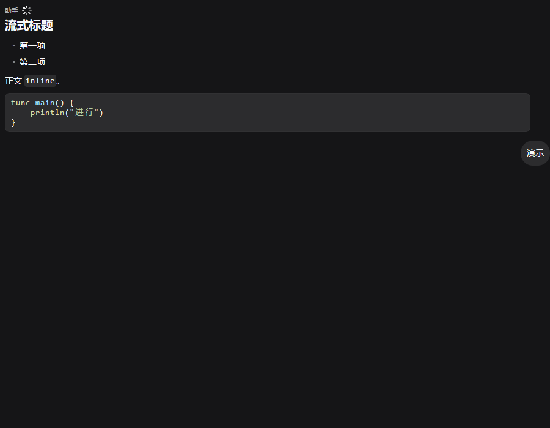
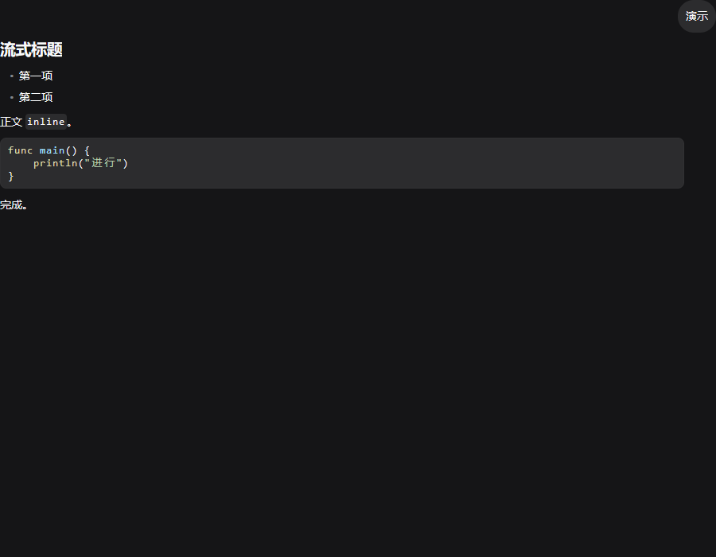

# MDSTREAM · 流式 assistant 正文与定稿共用 Markdown 渲染

- 日期：2026-11-04；owner：MDSTREAM。
- 指定 base：`f007fad`。开工时 HEAD 为 `f298be8`，最终核对时外部已推进到 `9a155c7`；两者均在指定 base 之后。本 owner 未 commit / push。
- 改动范围仅 `plugins/dsconversation/**` 与本文件；`internal/mdlite` 现有高亮实现直接复用，无需改动。未改 `cmd/app`、共享文档或其他插件。

## 1. 结论

流式 assistant 正文不再走 `f.Wrap` 纯文本，而是与定稿共用 `layoutMarkdown`、`markdown.Document`、`components.MarkdownView` 和 `afterDraw`。标题、列表、行内码、fenced code block 均在流式期间真实绘制；未闭合围栏在 EOF 也保持代码块，不追加伪造闭合符、不吞代码文本。

流式缓存下标使用 `len(env.Data.Msgs)`：完成帧把同一正文追加为 assistant 消息时，它正好使用同一个下标。同正文、同宽度直接命中既有缓存，流式转定稿不更换解析器或 `MarkdownView`。

## 2. 官方与当前实现核对

官方 [`AssistantMarkdown`](../tmp/dsh-client-ui-chat.js#L6290-L6311) 对 `block.kind == "text"` 始终构造 `MarkdownText`，并原样传入 `streaming`；不是流式退成纯文本、定稿才升级 Markdown。

本仓 [`internal/mdlite/highlight.go`](../internal/mdlite/highlight.go) 已提供 `MarkdownStyle.Highlight`，定稿路径也已有文档/视图缓存。Viva `markdown.Document.Parse` 在源码结束仍位于围栏内时执行 `finishCode`（`github.com/vivaui/viva@v0.2.3/markdown/markdown.go:284-286`），所以未闭合围栏可以直接使用同一路径，不需要额外的流式文本修补层。

生产改动只有 [`drawStreaming`](../plugins/dsconversation/conversation.go#L260-L283)：计算与定稿一致的正文宽度，调用 `layoutMarkdown`，再把同一个消息下标登记到 `mdSlot`，由现有 `afterDraw` 实画。思考、工具、用户分支及历史消息 LOD 未改。

## 3. 先红后绿与自动断言

测试先行文件：[`streaming_markdown_test.go`](../plugins/dsconversation/streaming_markdown_test.go)。旧实现首次运行 exit **1**，实际看到：

- 标题仍是普通字重的 `# 流式标题`，列表仍是 `- 第一项`，行内码仍带反引号；
- 流式正文没有 `MarkdownView`；空代码块、追加半个标识符、未闭合围栏、闭合围栏四个用例全部失败；
- 流式/定稿缓存连续性用例失败。

最小实现后，同一命令 exit **0**。当前断言覆盖：

1. `TestStreamingMarkdownReallyDrawsHeadingListAndInlineCode`：标题字重、真实 `•` 列表标记与列表正文、`inline` 的 mono 样式，且不存在整段 `f.Wrap` 原文。
2. `TestStreamingMarkdownOpenFenceStaysCodeAndKeepsText`：四种增量前缀始终保持一个代码块，`Codes()[0].Text` 与已到达代码逐字一致，可选择正文不丢代码，完整开围栏后不闪回原始反引号。
3. `TestStreamingMarkdownReusesFinalMessageCacheSlot`：流式与定稿复用同一个 `MarkdownView`，同正文同宽度高度一致。
4. `TestStreamingMarkdownLayoutCacheBoundsRepeatedFrames`：首次排版后重复 8 个未变化帧，文本测量次数不增长；真正追加正文时才重排。
5. `TestStreamingMarkdownHeadlessFrames`：同一无头会话依次推进三个前缀帧，再转为定稿；两阶段都检查标题、列表标记、行内/块级 mono、代码底色 primitive、代码块数量与原始 Markdown 标记消失。

## 4. 无头合成流式实图

抓图命令：

```bash
MDSTREAM_CAPTURE_DIR="$PWD/plugins/dsconversation/testdata/streaming-markdown" \
CGO_ENABLED=0 go test ./plugins/dsconversation -run TestStreamingMarkdownHeadlessFrames -count=1 -v
```

退出码：**0**。两图均由 Viva offscreen renderer 当场生成，逻辑尺寸与 PNG 像素尺寸均为 **900×700**，不是 DOM 文本快照或手工示意图。

| 阶段 | 证据 | 字节数 | SHA-256 | 真实断言 |
|---|---|---:|---|---|
| 进行中，围栏未闭合 | [`streaming-in-progress.png`](../plugins/dsconversation/testdata/streaming-markdown/streaming-in-progress.png) | 20670 | `9b272af7b41c314ef8aff16fa022ead629336292a1608bd3e2fd6a78ed60a3bf` | 1 个代码块、代码底色实画、列表标记、行内/块级 mono；无原始围栏 |
| 完成，围栏闭合并转定稿 | [`streaming-done.png`](../plugins/dsconversation/testdata/streaming-markdown/streaming-done.png) | 20852 | `eee9d8308f5b6b940e746ccd1724203869356da041585665a803901fe42d7109` | 同上，另显示围栏后的 `完成。` |

进行中：



完成：



## 5. 命令与退出码

| 命令 | 退出码 | 结果 |
|---|---:|---|
| `CGO_ENABLED=0 go test ./plugins/dsconversation -run 'TestStreamingMarkdown' -count=1 -v`（旧实现） | **1** | 按预期红：纯文本与无流式 `MarkdownView` |
| 同上（最小实现后） | **0** | 流式 Markdown、围栏、缓存与无头实画全通过 |
| `MDSTREAM_CAPTURE_DIR="$PWD/plugins/dsconversation/testdata/streaming-markdown" CGO_ENABLED=0 go test ./plugins/dsconversation -run TestStreamingMarkdownHeadlessFrames -count=1 -v` | **0** | 生成上表两张 PNG，并执行真实绘制断言 |
| `CGO_ENABLED=0 go test ./internal/mdlite ./plugins/dsconversation -count=1` | **0** | 两包均 `ok` |
| `CGO_ENABLED=0 go vet ./internal/mdlite ./plugins/dsconversation` | **0** | owned 包 vet 通过 |
| `CGO_ENABLED=0 go vet ./...` | **0** | 最终全仓复验通过 |
| `CGO_ENABLED=0 go build -o /tmp/mdstream-app-final.exe ./cmd/app` | **0** | app 构建成功，产物实际存在；SHA-256 `029f3f041c30986a85defaa9b1e175066fa4cdc21de085288a65c24409d19cd1` |
| `git diff --check -- plugins/dsconversation internal/mdlite` | **0** | 无空白错误 |

## 6. 未验证 / 边界

- 无头图使用**合成快照帧**，证明真实 flex/Markdown 布局与像素绘制；本轮未启动真 dshd、未调用真模型，不把它冒充真 Transport 生成证据。
- 性能结论是结构性有界：只在文本或宽度变化时解析/排版，未变化帧不重排，流式与定稿共用缓存。未做长正文吞吐量、p95 帧时延或整进程内存基准，不宣称常量时间增量解析。
- 既有思考与工具分支未改，并随 `plugins/dsconversation` 全包测试通过；本轮没有另拍真实 reasoning/tool/approval 组合帧。
- 高 DPI、OS 键盘、滚动手感与真实窗口管理器不在本包验收范围。
