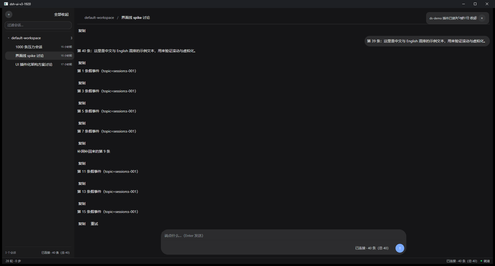
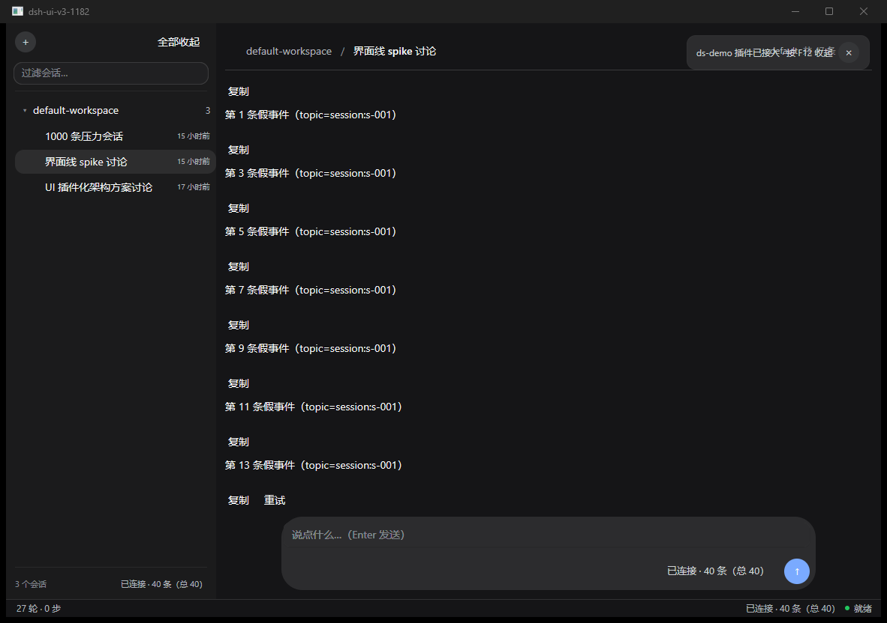
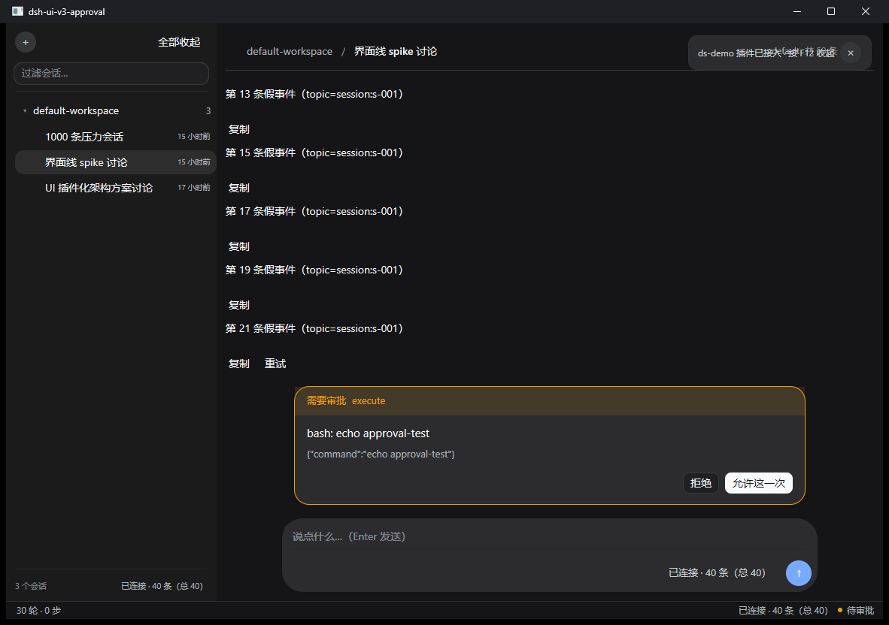
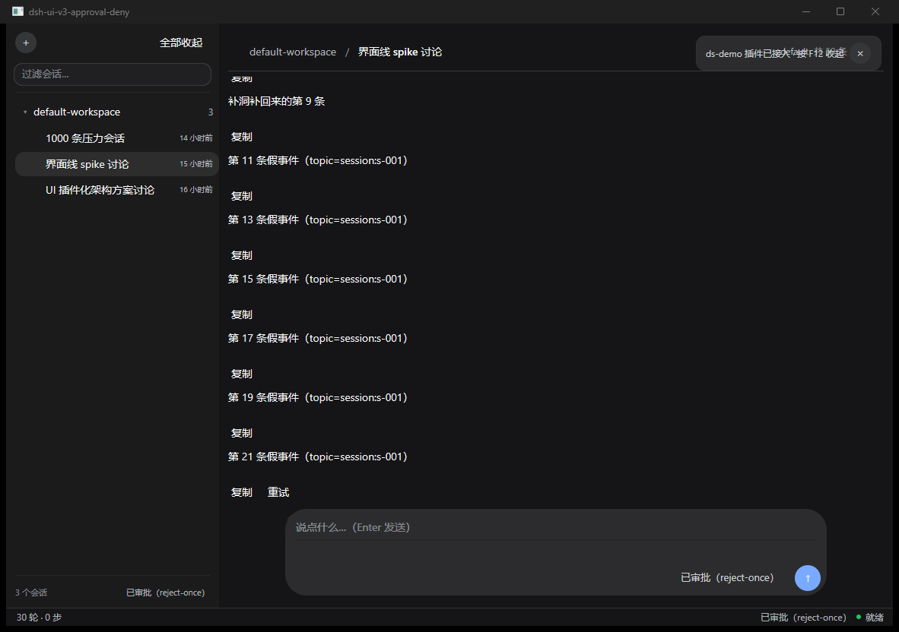

# V3 · Composer 官方视觉与行为证据

日期：2026-11-03  
基线：`bf7e8885a73a21d839d46c0684eab41d6e20f5e1`  
范围：`plugins/dscomposer/**` 与本证据文件。未改 `cmd/app`、共享契约、其他插件；未执行 commit/push。

> 并行说明：施工期间其他 owner 推进了共享工作区 HEAD，并写入过 composer；本报告基于最终工作区重新测试、重抓图，不回退他人修改。上文“未执行 commit”仅指本 owner 的动作。

## 1. 官方来源与落地

### 1.1 Composer

官方源：`tmp/asar-css/036__ConversationRoot.module.css.mjs.css`、`039__InputBar.module.css.mjs.css`，以及 `tmp/official/dsh-client-ui-conversation/client.js` 的 InputBar DOM。

| 项目 | 官方规则 | 实现 |
|---|---|---|
| 内容宽度 | `clamp(680px, column*.64, 920px)` | `contentWidth()` |
| 卡片最大宽 | `content + 32px` | `cardWidth()`，不是整窗 100% |
| 居中与侧边 | `side-clearance:16px`；壳已有左右 12，插件补 4 | `draw()` / `drawCard()` |
| 卡片 | `border:0`、`radius-panel:28px`、`InputMajor`、顶 padding 8、gap 12 | `drawCard()`；Viva `ShadowXS` 只承担近似 elevation |
| 输入高度 | 普通 `.input{min-height:36px}`；`.hero .input{min-height:52px}` | active 卡高 98，hero 卡高 114；两档均有测试 |
| 输入文字 | 14px/24px；padding `4px 8px 0 14px` | `drawInput()`；保留同一个 `flex.Field` |
| 控件行 | `padding:2px 8px 6px; gap:12px` | 控件行与发送键等效上移 2px |
| 主按钮 | 34×34、999px 全圆角、`button-info-fill` | `sendButton()`：34×34、`RadiusFull`、`theme.Info` |
| 控件层级 | 左 modes：permission/plan；右 standardControls：model；随后 activity、primary | permission 在左；model、status、发送/停止在右 |
| model/permission trigger | 高 28、13px/20px、radius-sm | 只读真值标签；无目录/切换 Action，所以不画 chevron、不接点击 |

实现入口：[composer.go](../plugins/dscomposer/composer.go)（布局与输入 167–273 行，控件层级 275–382 行，宽度计算 411–449 行）。

Viva 的 `PaintInput` 固定画输入底色和边框。`AfterDraw` 用同一个 `InputSnapshot`、同一 `flex.Field` 状态重绘表面为 `InputMajor`；没有另写一套输入、光标或 Enter 行为。

### 1.2 Approval

官方源：`tmp/asar-css/006__ApprovalPanel.module.css.mjs.css`。

- root：上 padding 8、下 padding 12；与 composer stack gap 6 合计净间距 18。
- card：`chat-content-width`、1px warn 外框、`radius-xl:20px`、`InputMajor`。
- strip：padding `10px 16px`、13px/18px。
- body：padding `12px 16px 0`、gap 6；标题 15px/24px，参数 13px/20px。
- actionRow：padding `14px 16px`、gap 8、右对齐。
- Allow / AllowAlways / Deny 仍走原 `press` / `pressOption`，原样回传 `requestId` / `optionId`。

实现入口：[approval.go](../plugins/dscomposer/approval.go)（332–416 行）。

## 2. 测试先行与最终验证

新增 [composer_test.go](../plugins/dscomposer/composer_test.go) 后，先在旧实现上运行并抓到红灯，再改实现：

- 修改前并行工作区的 hero 卡片：两尺寸填充宽 **950 / 710**、高 **97**、圆角 **27**；目标为 **952 / 712**、hero 高 **114**、圆角 **28**。
- 控件层级反证：曾出现 `modelX=169.90 < cardCenter=439.00`，即 model 被错放左 modes；最终测试同时断言 model 位于右 trailing。
- 发送 trim+清空、Busy 时只 Cancel、无审批 Esc 取消在修改前即为通过项，作为防回归门槛保留。

最终命令：

```bash
CGO_ENABLED=0 go vet ./plugins/dscomposer
CGO_ENABLED=0 go test ./plugins/dscomposer -count=1 -v
CGO_ENABLED=0 go build -o /tmp/dscomposer-v3/app.exe ./cmd/app
CGO_ENABLED=0 go build -o /tmp/dscomposer-v3/mockd.exe ./cmd/mockd
```

结果：vet 通过；包内全部测试 `PASS`；两个二进制均 exit 0。`gofmt -l plugins/dscomposer` 无输出，`git diff --check -- plugins/dscomposer` 通过。

测试实际断言包括：

- 1920 / 1182 两种主区下，hero 114 与 active 98 两档卡高、952 / 712 卡宽、居中 x、28 圆角。
- 主按钮 34×34、Info 填充、全圆角。
- model / permission / status 真值与空值；model 在右 trailing；未知不显示默认型号、权限占位、附件/命令加号或 chevron。
- 发送按钮 trim 后只发一次并清空；Busy 时只 Cancel；无审批 Esc 走 Cancel。
- 审批表面、18px 净间距、标题/参数行高；三个实际按钮事件分支和键盘分支均原样转发 ID。

## 3. 无头截图与负责容器几何

抓图均用本轮新构建二进制、专属随机端口 mockd、`-rightbar=false`。Windows 外框会让小窗口 PNG 比 client 大 16×39，因此小图用 client `1166x793` 得到**精确 1182×832 PNG**；1920 图直接得到 1920×1032。

```bash
/tmp/dscomposer-v3/app.exe -addr http://127.0.0.1:52583 -rightbar=false \
  -size 1920x1032 -shot-wait 2 -title dsh-ui-v3-1920 \
  -shot plugins/dscomposer/testdata/visual-v3-1920.png
/tmp/dscomposer-v3/app.exe -addr http://127.0.0.1:52583 -rightbar=false \
  -size 1166x793 -shot-wait 2 -title dsh-ui-v3-1182 \
  -shot plugins/dscomposer/testdata/visual-v3-1182.png
```

PNG 用 Pillow 对 `InputMajor=(44,44,46)` 扫描；下列宽/高由 inclusive bbox 转为矩形尺寸。圆角与 34px 主按钮尺寸由 retained canvas 断言，不用圆角内部色块冒充外接尺寸。

| 负责容器 | 官方目标 | PNG 实测 | 偏差 |
|---|---|---|---|
| 1920 active composer | 宽 952、高 98、中心 x=1100、R28 | x=624、y=890、**952×98**、中心 x=1100 | 宽/高/中心 **0px**；R28 测试通过 |
| 1182 active composer | 宽 712、高 98、外框坐标中心 x=731、R28 | x=375、y=690、**712×98**、中心 x=731 | 宽/高/中心 **0px**；R28 测试通过 |
| 1182 approval（2 选项，无 detail/note） | 宽 680、高 158、R20、距 composer 18 | 外框 x=391、y=514、**680×158**；composer y=690 | 宽/高/间距 **0px**；R20 测试通过 |

以上均小于验收上限 8px。全窗绝对 y 还包含壳与 Windows 装饰，因此只记录实测 y，不把它伪称为官方 CSS 直接给出的常量。

### 3.1 1920×1032



### 3.2 1182×832



两张图均为 active 会话。mockd 没给 model/permission，二者整段隐藏；status 显示真状态，未编默认型号或权限。

## 4. 控件矩阵

| 控件 | 当前行为 | 真值 / 空值规则 | 证据 |
|---|---|---|---|
| 输入 | 原 `flex.Field`；Enter 发送 | 草稿属于插件，非宿主字段 | 点击/提交测试；两尺寸截图 |
| 发送 | 34px 主按钮；trim 后 Send 一次并清空 | 空草稿不发送 | `TestSendButtonPreservesTrimAndClearBehavior` |
| 停止 | Stream 或 Busy 时替换主按钮，只 Cancel；Esc 路由保留 | 不运行时显示发送 | `TestStopButtonPreservesCancelBehavior`、`TestEscapeWithoutApprovalPreservesCancelRoute` |
| model | 右 standardControls 的只读当前值 | 空/空白整段隐藏；无目录、无切换 Action，不画假下拉 | 真值与位置测试；空值测试 |
| permission | 左 modes 的只读当前值，以“审批 <原值>”避免与 mode 混淆 | 空/空白整段隐藏；不拿 mode 顶替 | 真值与空值测试 |
| status / activity | 右 trailing；优先原 Status，Busy/Stream 无文本时才推导“正在生成” | 完全未知隐藏 | `TestActivityLabelTruthAndEmptyStates`；截图 |
| busy dot | Busy/Stream 时 8px Info 圆点 | 不运行不画 | 实现与 stop 行为测试；本轮未单独抓运行态像素 |
| 审批 | Approval 非空才画；Allow/AllowAlways/Deny 各回自己的 ID | 无 Approval 整条不占位；选项不可用时禁用 | 全部 approval 测试；下方前/后态截图与 mockd 回传日志 |
| 附件 | **不画** | 当前 Snapshot/Actions 无附件草稿、添加、删除、预览或 prompt 附件载荷 | 缺口见 §6；空值测试禁止“附件”和加号假按钮 |
| 命令加号 | **不画** | 无 `ToggleCommandMenu` 真实 Action | 空值测试禁止加号假按钮 |

## 5. 审批前后态与真实回传证据

前态命令使用最终审批 mockd `http://127.0.0.1:52585`；后态使用独立新实例 `http://127.0.0.1:52586`，确保各自推一次审批帧。

```bash
/tmp/dscomposer-v3/app.exe -addr http://127.0.0.1:52585 -rightbar=false \
  -size 1166x793 -shot-wait 3 -title dsh-ui-v3-approval \
  -shot plugins/dscomposer/testdata/visual-v3-approval.png
/tmp/dscomposer-v3/app.exe -addr http://127.0.0.1:52586 -rightbar=false \
  -size 1166x793 -keys esc -keys-after 2 -shot-wait 3 \
  -title dsh-ui-v3-approval-deny \
  -shot plugins/dscomposer/testdata/visual-v3-approval-deny.png
```

前态：



后态：



后态应用日志：

```text
待审批 requestId=perm-mock-1 tool=execute options=2
INFO ds-composer: 审批（键盘）：拒绝 → reject-once
key 4 handled=true
approve 成功 requestId=perm-mock-1 option=reject-once
shot: 已保存 plugins/dscomposer/testdata/visual-v3-approval-deny.png
```

对应 mockd 服务端日志：

```text
mux: 推了一条 approval/request（requestId=perm-mock-1）
approve: requestId=perm-mock-1 optionId=reject-once（界面回传成功）
```

这证明插件经真实 HTTP mock endpoint 原样回传，不只是本地气泡消失。所有本轮启动的 mockd 均按 job 回收；未杀其他进程。

## 6. 明确缺口与未验证项

1. **附件未实现**：没有真实附件数据与 Action，故不显示附件按钮、rail、删除或预览；上传/粘贴/拖放/附件 prompt 载荷均未验证。
2. **model/permission 选择未实现**：目前只消费当前真值，没有候选目录和 Select/Set Action，所以是只读标签，不实现菜单、effort、风险确认；不画 chevron 冒充可点。
3. **命令菜单未实现**：无真实命令 Action，官方加号不落地。
4. **多行编辑器未验**：当前仍是单行 `flex.Field`，不是官方完整 contenteditable；本轮没有新增 IME、长文、多行滚动、附件 chip 行为证据。
5. **真宿主字段链未在本轮重跑**：model/permission 的真值证据是 Snapshot 级测试，空值截图来自 mockd；不声称本轮重新完成真 dshd 的 H4/H5 端到端验收。
6. **真工具执行未在本轮重跑**：审批截图与回传日志来自契约形状正确的 mockd；不能据此宣称 allow 后真工具执行、deny 后真工具未执行。按钮/键盘原样 ID 回传已验。
7. **颜色近似项**：composer 用 Viva `ShadowXS` 近似官方 `elevation-soft`；审批 strip 因主题没有 `warn-tertiary`，由 `theme.Warn` 派生 alpha 0.12，外框用 `theme.Warn` 而非缺失的 warn-secondary。几何已验，精确官方阴影/警告色未验。
8. **审批参数等宽字体未还原**：保留既有比例字省略号路径，避免长参数被硬裁；官方 `.command` 的 code font 与本轮未完全对齐。
9. **运行态动画未验**：busy dot 不做 1s 明暗动画；本轮未抓停止键运行态截图，停止行为由事件测试覆盖。
10. 本轮按任务运行定向包测试与 app/mockd 构建，未以全仓 `go test ./...` 或单张截图替代整产品验收。
