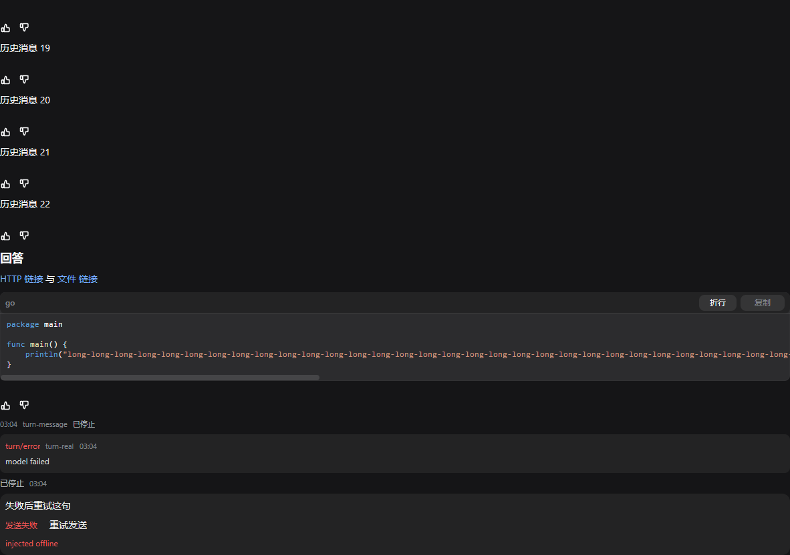
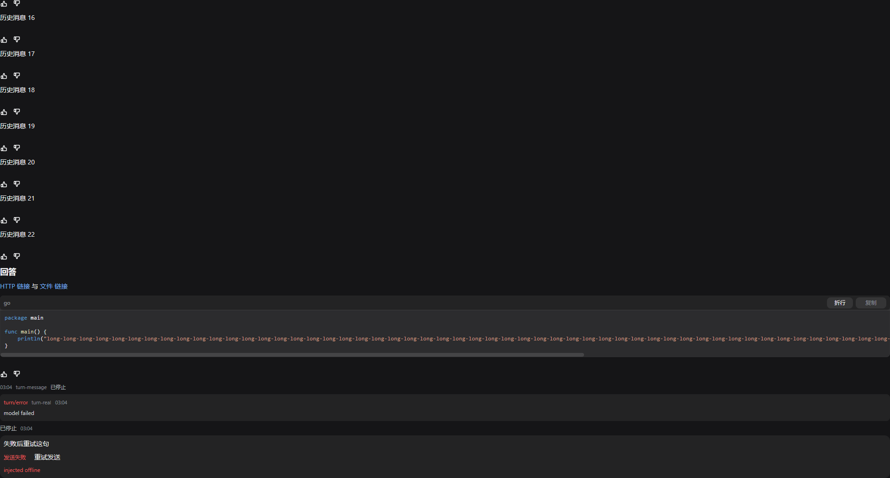

# WP-C1：消息区第一批可闭环整合验收（rebased）

> 日期：2026-11-04。Owner：WP-C1 rebase/integration。工作目录：`C:\Users\Administrator\AppData\Local\Temp\dsh-ui-wpc1-rebase2`。
>
> Rebase 基线：`3102e055be12c6f5a3ddb0343042dc33907c6c98`（`3102e05`），其中保留共享树已验证的 A 类 dstool/dsbrand/message-feedback、B 类 sidebar-files/documentpreview、FG Chrome/header/composer/dock、MSGID/MDSTREAM/WP-B1。原 WP-C1 包基线为 `654273546846e11b418615936fe8d7dde87b7e7c`（`6542735`），来源目录为 `C:\Users\Administrator\AppData\Local\Temp\dsh-ui-wpc1-isolated`。
>
> 本次按代码语义选取 `plugins/dsconversation/**`、`pluginapi/**`、`cmd/app/**` 与本文，没有用原整份 patch 覆盖共享树，没有改 dstool、dsbrand、apiclient、mdlite 或其他插件，也没有 commit/push/杀进程。

## 1. 交付范围与保留功能

- **稳定视图身份**：[MessageKey](../pluginapi/message_key.go#L12) 依次使用 `V4Seq`、`MessageID`、`TurnID/Turn+Step`、旧 load 的 `v4-load:Seq`，最后才是 `session+index` 局部键；角色与 `CallID` 也在键内。思考/工具展开、复制、重试、代码块和链接 scope 不再使用裸 `msg.Seq`，未知 `Seq=0` 不互相碰撞，也不跨会话串状态。
- **Outgoing 发送态与失败草稿**：[sendLocal](../cmd/app/wpc1_send.go#L13) 使用独立的 `OutgoingMessage{Key,Text,State,TurnID,Error}`，不向 `apiclient.Message` 写 `Seq:-1`，也不借 Transport journal seq。失败保留原文、可见错误和重试态，并在输入框为空时回灌原草稿；[retrySend](../cmd/app/wpc1_send.go#L38) 只重试同一 key 的原草稿。durable user event 到达后才清本地 echo，历史同文本不参与对账。
- **CodeBlock 接入**：[paintMarkdown](../plugins/dsconversation/wpc1_render.go#L87) 保留同一 `MarkdownView`/流式缓存，用分段覆画把 fenced code 替换成真正的 `mdlite.CodeBlock`。语言 banner、原字节复制、成功/失败原位反馈、wrap toggle、横滚均可用。[HandleScroll](../plugins/dsconversation/wpc1_render.go#L76) 只处理代码视口的横向或 Shift+纵向手势，普通纵向滚轮继续走消息区 `View.Wheel`。
- **真实链接与 OS 动作**：HTTP(S)/mailto 由 Markdown hit region 回调；显式 `file://` Markdown destination 经 [rewriteExplicitFileLinks](../plugins/dsconversation/wpc1.go#L151) 保留文件语义。普通字符串、行内码和 fenced code 不猜成文件。[copyText/openExternal/openFile](../cmd/app/wpc1_actions.go#L19) 分别调用 Viva 的真实 `app.SetClipboardText`、`app.OpenURL`、`app.OpenPath`；错误写状态栏，代码复制错误同时显示在 banner。`#L24-L30` 不进入文件名。
- **真值与终局**：[loadSession](../cmd/app/wpc1_data.go#L18) 在不改共享 apiclient 的前提下保留原始消息 `time/stopped`；history 的 `Frame.Time` 与 data 内 `time` 也保留。[recordTurnEventsLocked](../cmd/app/wpc1_data.go#L69) 保存 `turn/error` 与显式 stopped/interrupted。缺 `TurnID` 或时间就不画对应字段，不按消息下标编 turn，不把取消 HTTP 成功本身当成 stopped。
- **审批与既有工作包**：审批 `requestId/optionId` 的解析、快照和回传路径未改；MDSTREAM 流式与定稿共用缓存；message-feedback、B 类文件树/预览、FG Chrome/header/composer/dock 均保留。

## 2. Rebase 冲突处理

1. **dstool Renderer 分派 vs. 稳定 MessageKey**：现行 [conversation.go](../plugins/dsconversation/conversation.go) 已把工具卡抽给 `dstool.Service`，其公开接口仍以 int 作内部展开键。没有恢复旧巨型 `drawTool/drawCard/drawTable`，也没有改 dstool；在 [toolRenderID](../plugins/dsconversation/wpc1.go#L19) 内建立 `MessageKey → 进程内唯一 int` 的适配，再把 `Tool/Args/Summary/View` 交给原 `dstool.Service`。Renderer 分派和徽标仍只有一份，未知 Seq、同 Seq 不同 CallID、跨会话均不共享展开状态。新增适配单测；A 类 `toolcard_capture_test.go` 仍按输入 v4 seq 选消息并真实点击，但经同一适配计算命中 ID 和断言展开状态，没有放宽行为断言。
2. **dsbrand/message-feedback**：保留现行 `dsbrand.Service` 注入、品牌默认回退和 `drawFeedback` 调用；WP-C1 只改变复制/重试的渲染 key，不覆盖 A 类反馈实现。`drawActions` 的新 key 参数与反馈所需的消息 index 同时保留。
3. **FG/headless**：当前 `cmd/app/headless_windows.go`、`headless_other.go` 与原 WP-C1 包逐字一致，`main_test.go` 也一致，因此没有重复套用这些 hunks。现有 `startShot`、Chrome probe/report 和 FG 测试保持原样。
4. **MSGID/MDSTREAM/WP-B1**：稳定键直接消费现行 `apiclient.Message` 的 MSGID 字段；流式仍走原 `layoutMarkdown` 下标与缓存；CodeBlock 通过分段 Paint 替换 fenced code，而不是恢复旧 overflow 叠画方案。
5. **壳层新能力并存**：在现行 FS/Config/Frame Chrome 接线上只追加 `MessageMeta/TurnEvents/Outgoing` 快照、`CopyResult/OpenExternal/OpenFile/RetrySend` 动作和 `ScrollHandler` 分派；B 类 `FSList/FSRead` 与审批原 ID 路径未改。

## 3. 命令与退出码

开工基线先跑：`CGO_ENABLED=0 go test ./pluginapi ./plugins/dsconversation ./plugins/dstool ./plugins/dsbrand ./cmd/app -count=1`，**exit 0**。合并过程中 A 类工具点击测试曾因命中 ID 仍假定裸 Seq 而按预期变红；按第 2 节完成语义适配后，同一真实点击/展开断言转绿。

最终命令均在本 rebase 工作目录执行：

| 命令 | 退出码 | 日志/结果 |
|---|---:|---|
| `CGO_ENABLED=0 go test ./pluginapi ./plugins/dsconversation ./plugins/dstool ./plugins/dsbrand ./plugins/dssidebar ./plugins/dsfiles ./cmd/app -count=1` | **0** | [targeted-green.log](../cmd/app/testdata/wp-c1/targeted-green.log)；WP-C1、A 类 dstool/feedback、B 类 sidebar 与壳测试通过；dsbrand/dsfiles 当前无测试文件但参与编译 |
| `CGO_ENABLED=0 go test ./plugins/dssidebar ./plugins/dsfiles ./internal/mdlite -count=1` | **0** | B 类 sidebar、文件预览所属包与 WP-B1 CodeBlock 包通过 |
| `CGO_ENABLED=0 go test ./... -count=1` | **0** | [full-test.log](../cmd/app/testdata/wp-c1/full-test.log)；全仓所有包通过 |
| `go vet ./...` | **0** | [full-vet.log](../cmd/app/testdata/wp-c1/full-vet.log)；无输出 |
| `GOCACHE=C:/Users/Administrator/AppData/Local/Temp/wp-c1-rebased-gocache.wE22E4 CGO_ENABLED=0 go build ./...` | **0** | [full-build.log](../cmd/app/testdata/wp-c1/full-build.log)；独立缓存，全仓构建成功 |
| `git diff --check -- plugins/dsconversation pluginapi cmd/app docs/wp-c1.md` | **0** | 无空白错误 |

## 4. 无头真实点击、滚动与两尺寸实图

重新生成证据的命令：

```bash
export WPC1_CAPTURE_DIR="C:/Users/Administrator/AppData/Local/Temp/dsh-ui-wpc1-rebase2/cmd/app/testdata/wp-c1"
CGO_ENABLED=0 go test ./cmd/app \
  -run '^TestWPC1HeadlessRealActionsAndTwoSizeEvidence$' -count=1 -v
```

结果：**exit 0**，1182×832 与 1920×1032 两个子测试均 PASS；完整输出见 [headless-green.log](../cmd/app/testdata/wp-c1/headless-green.log)。测试使用 Viva `headless.Session` 的真实 Paint、HitTest、ClickLabel、Scroll、AfterPaint 和 PNG renderer，不是直接调用绘制纯函数冒充点击。

实际断言：

1. 点击代码复制后，headless OS driver 的 Clipboard 与 fenced `block.Text` 逐字节相等；成功显示 `已复制`，注入 `clipboard busy` 后原位显示 `复制失败`。
2. 点击 HTTP 文本后 `LastOpenedURL == https://example.com/docs`；点击含空格与 Unicode 的 `file:///...#L24-L30` 后，`LastOpenedPath` 等于真实临时 `.txt` 绝对路径，行号片段未混入路径。
3. 代码上横向 `DeltaX` 后代码 X 坐标左移而消息区 Offset 不变；普通纵向 `DeltaY` 后消息区 Offset 减小，未被代码块吞掉；点击 `切换折行` 后出现 `横滚` 状态。
4. 点击 `重试发送` 后，httptest Transport 收到一次真实 `session.prompt`，正文严格等于失败草稿；返回的 `turn-retry-real` 原样进入 sent 状态。
5. 首帧同时包含时间、`turn-message`、`turn/error`、`turn-real`、`model failed`、两处 `已停止`、`发送失败` 和 `重试发送`；缺字段保持零值/隐藏。

### 1182×832



- 40,230 bytes；SHA-256：`4cfdbd585ca5a14e0506dd13e3ab9e8164a6fb15b095560477cc7e03ee2da6f9`。

### 1920×1032



- 63,255 bytes；SHA-256：`46f93a4c8e53ed347e044e2e76f27b11249799553c5026d8fce1c8ae953d4b30`。

两张图均在本次 rebase 目录重新生成并读取复核，能对应语言 banner、复制/wrap、横滚、链接、`time`、`turn/error`、stopped 和失败重试；行为正确性由上面的独立断言证明，不只靠截图。

## 5. 未验项与剩余 WP-C

1. 没有启动真实 dshd 做生成/重连端到端；本次证明的是全仓回归、壳/插件归约、httptest 真实 prompt 和 Viva OS capability 接线。headless driver 记录真实 `SetClipboardText/OpenURL/OpenPath` 请求，未在桌面弹出浏览器，也未污染用户系统剪贴板。
2. 当前共享 `apiclient.Event` 尚未暴露 live WS 信封 `time`，本包又不能改 `internal/apiclient`；因此已保留 load、history `Frame.Time` 与 data 内 `time`，live 信封时间拿不到时仍隐藏。后续应由 apiclient owner 补 `Event.Time` 后接入同一 `MessageMetadata`，不得用本地墙钟编造。
3. Transport 尚无 `rpcId`，本地 echo 只按本次新到 durable user event 的文本做有限对账，不宣称跨进程/同文本多轮的持久身份闭环。失败态不靠同文本自动清除。
4. 文件打开使用 `app.OpenPath`；`#L24-L30` 被正确剥离但尚未实现编辑器逐行定位。相对路径/普通字符串不自动升级为文件。
5. dstool 的公开 Service 仍只接受 int；本次适配保证 dsconversation 进程内稳定且隔离，没有把该局部 int 冒充持久消息身份。若以后要跨重启保存工具展开态，应由 dstool owner 将公开键升级为稳定字符串，而不是持久化此适配编号。
6. dsfiles 当前没有独立 Go 测试；本次运行了其所属包编译、cmd/app 相关测试与全仓测试，没有重新生成 B 类文件树/预览视觉证据。
7. 未吞完整 WP-C：后台正文缓存与 A→B→A 免重放、完整工具 preparing/running/stopped 树与专用卡、已加载 Turn shell/页脚/导航、prepend/回底语义锚点、向前历史、附件/引用与宿主反馈仍留后续工作包。

最终交付 patch：`C:\Users\Administrator\AppData\Local\Temp\wp-c1-rebased-final.patch`。只对必要新文件执行 `git add -N`，没有 commit。
