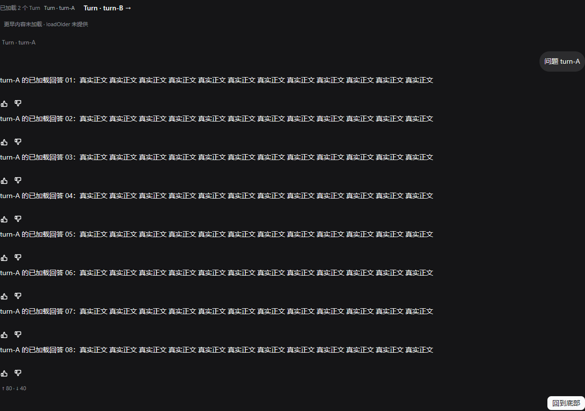
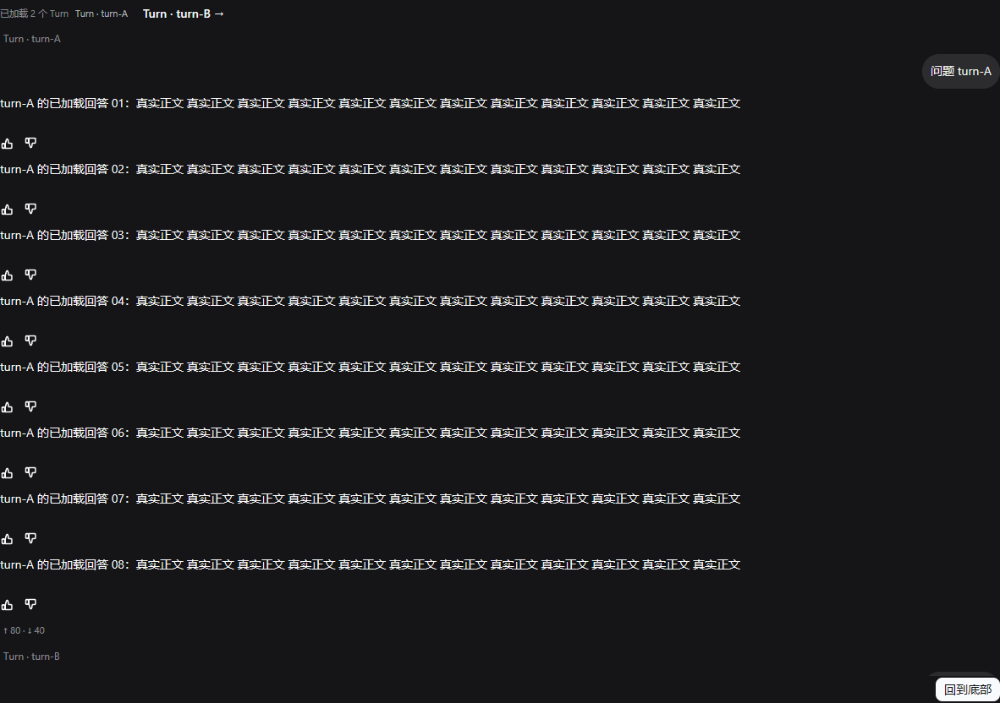
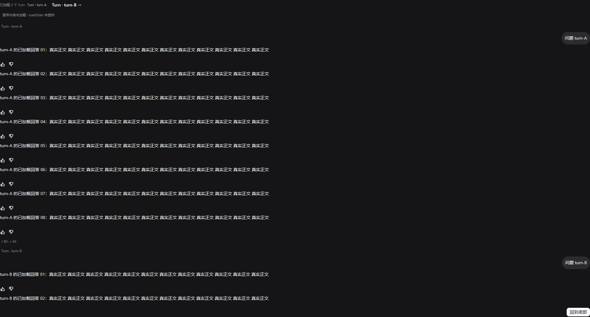
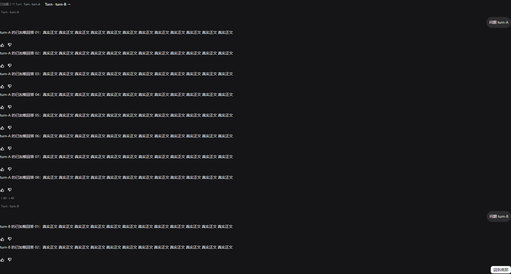

# WP-C2：Turn、后台连续性与阅读位置第二批整合验收

> 日期：2026-11-04。原 Owner：WP-C2；rebase + Event.Time integration Owner：本批壳侧 owner。原施工目录：`C:\Users\Administrator\AppData\Local\Temp\dsh-ui-wpc2-isolated`；rebase 目录：`C:\Users\Administrator\AppData\Local\Temp\dsh-ui-wpc2-rebase`。
>
> 原基线：`d71c65ed4ce6589ab511806e593869b0e3ce3240`（`d71c65e`）+ 当时共享导出。**Rebase rev：`efd46ab301987e76fc744a076a39a1601751c624`（`efd46ab`）+ 最新共享导出**，其中已有 A/B/FG、schedule/deliverables/jobs、WP-C1、MSGID/MDSTREAM/WP-B1 与 apiclient.Event.Time。只改 `plugins/dsconversation/**`、`pluginapi/**`、`cmd/app/**` 与本文；没有改 internal/apiclient、dstool/dsbrand、宿主或共享 Transport 契约，没有 commit/push，没有杀进程。

## 1. 交付行为

### 1.1 已加载 Turn shell、真实页脚与导航

- [wpc2_turns.go](../plugins/dsconversation/wpc2_turns.go) 只按消息里的真实 `TurnID` / `turn` 对**当前已加载的连续消息段**建壳；同一 Turn 的多条 assistant 仍是一个 Turn，不用 assistant 数或数组下标造轮次。缺身份的消息保持平铺，缺身份的 Turn 不造标题。
- 页脚聚合该 Turn 已有 `usage`：input/output 可跨真实 usage 记录相加；`totalTokens` 是单次请求上下文量，多条记录时不累加、不展示。时间只取 `MessageMetadata.Time` 与匹配 TurnEvent.Time；状态只取真实 `turn/done`、`turn/error`、stopped/interrupted，或与 `ActiveTurnID/ActiveTurn` 精确匹配的 busy。全部未知时页脚隐藏，不编 0、不用本地墙钟补时长。
- 上一/下一 Turn 导航只遍历已加载分组，使用 AfterDraw 提取的真实布局矩形定位。明确 AtEnd 时当前项为最后一个已加载 Turn；不生成未加载 Turn 大纲。
- [message_key.go](../pluginapi/message_key.go) 保留 v4/MessageID/TurnID+Step 的 MSGID 优先级；只有 TurnID/turn 而缺 Step 的多条同角色消息，显式降级为当前窗口局部消歧键，避免时间、复制和展开状态互相覆盖。真实 TurnID+Step 不随下标变化。

### 1.2 后台 canonical 缓存与 A→B→A

- [wpc2_runtime.go](../cmd/app/wpc2_runtime.go) 为每个会话保存独立 `apiclient.Stream`、流正文、busy 与真实活动 Turn。前台 `msgs/streamText/busy` 只是 canonical 状态的发布副本；后台帧直接归并进该会话自己的缓存，不写另一会话前台。
- 温切不再取消/重建订阅，不再 `session.load` 或 `refreshSession` 重放整页。切回直接恢复已积累的增量正文、工具/思考消息、用量、阅读位置与活动状态；冷载和 journal reset 的原有基线路径保留。
- load 与 WS 并发时先合并 canonical 缓存，不能用较旧 tail 覆盖飞行期间到达的后台帧。前后台水位都随已消费帧前进，断号仍只经 history 补原始帧。
- 待审批也按会话缓存：A 的请求不在 B 显示，切回 A 恢复原 `requestId` 和全部 `optionId`；批准/拒绝仍只清同一条原请求，不靠重推恢复。

### 1.3 MSGID / Outgoing / 本地 echo 对账

- durable user event 优先按真实 TurnID + 正文精确对账，一次事件最多清一条本地 echo。
- Transport 尚无 rpcId；没有 TurnID 时仅在“非失败、同正文候选唯一”时做文本兜底。两个同文本待对账发送属于歧义，保持原状，不再一次全清；历史同文本仍不参与扫描，失败草稿仍需显式重试。
- 本地 echo 仍是独立 `OutgoingMessage`，不写 `Seq:-1`，不借 journal seq。失败草稿恢复、同一 key 重试与 WP-C1 HTTP prompt 路径未改。

### 1.4 阅读位置、显式回底与 prepend 真值

- 保留 Viva `Follow(true)` 的 detached 语义：只有用户明确位于底部时新内容才跟随；回看时新帧不改 Offset。每个会话仍保存/恢复自己的 Offset，首载后的补帧机制保留。
- `回到底部` 只在“有内容且非底部”时出现；点击调用真实 `ScrollToEnd`，回底后按钮隐藏并恢复 Follow。
- `session.load.truncated` 与 render limit 现在传入 Snapshot。没有 loadOlder 契约/动作时明确画出 `更早内容未加载 · loadOlder 未提供`；不画假 prepend 按钮、不编历史，也不把 history(sinceSeq) 当 loadOlder。

### 1.5 保留项

WP-C1 CodeBlock、原字节复制、wrap/横滚、HTTP/file 链接、失败重试、消息时间与 stopped、dstool/dsbrand/反馈、FG Chrome/header/composer/dock 均未替换。消息 TurnID 改由真实 shell 统一显示，避免壳内逐条重复。首载补帧、审批原 ID、断号补帧与 journal reset 路径保留。

### 1.6 Rebase 冲突处理与共享能力保留

- 原补丁 `git apply --check` 仅在 `cmd/app/main.go:87` 失败，其余文件检查通过；补丁 pre-image blob 不在当前对象库，未做整份覆盖或 reset。非 main 文件按原补丁应用，main.go 按字段、openSession、refreshSession、订阅水位、审批、事件归约、Snapshot 与初始化逐段合并。
- 共享侧 `dsdeliverables`/`dsschedule` blank import、schedules 拉取与 `Actions.ScheduleList`、jobs 既有装配均原样保留。原交付 main 与合并后 main 的语义 diff 已复核，剩余差异仅为这些共享能力、Event.Time 接线及 nil/冷载保护。
- A/B/FG、WP-C1、MSGID/MDSTREAM/WP-B1、dstool/dsbrand、schedule/deliverables/jobs 所在文件没有被本批替换；相关包和全仓测试均通过。

## 2. 先红证据

实现前新增回归并运行：

```bash
CGO_ENABLED=0 go test ./plugins/dsconversation ./cmd/app -run 'WPC2' -count=1 -v
```

结果：**exit 1（预期旧实现失败）**，完整输出见 [old-red.log](../cmd/app/testdata/wp-c2/old-red.log)。实际失败包括：

1. 后台完整回答没有进入 A 的缓存；
2. 一条无身份 durable event 把两条同文本 echo 全清掉；
3. 已加载 Turn 分组/页脚不存在；
4. 两尺寸回看首屏没有 loadOlder 缺真值提示，后续回底/导航也无从验收。

实现后同一组测试及后续补充的 ABA、审批、精确对账测试全部转绿；没有删除或放宽旧断言。

## 3. 行为断言

### 3.1 真实 model 归约与 A→B→A

[wpc2_reducer_test.go](../cmd/app/wpc2_reducer_test.go) 使用真实 `model.applyEventAt` 与 `model.openSession`，不是直接拼一张最终画面：

- A 收 `assistant/text=前半` → 切 B → A 在后台收 `后台后半` → 切回 A，流正文严格为 `前半后台后半`；turn/end 后落条正文与一直归约的结果相同。
- 两个会话已有温缓存和订阅；整个 A→B→A 与完成帧期间，httptest 计数为 **0 次 HTTP**，订阅 cancel 计数为 **0 次**。B 的前台与 canonical 缓存均未被 A 污染。
- 同一路径注入 A 的真实形状审批帧：B 不显示，切回 A 后 `perm-A-original`、`allow-original`、`deny-original` 原样恢复。
- 两条同文本 echo 在无 TurnID 时保留；指定 turn-1 时只清 send-1，send-2 保留。
- `turn/end` 的 TurnID/time 进入 done 页脚数据；`truncated=true,total=9` 原样进入缓存。

### 3.2 Turn、回看/回底、prepend 与两尺寸 Viva 实图

复现命令：

```bash
export WPC2_CAPTURE_DIR="C:/Users/Administrator/AppData/Local/Temp/dsh-ui-wpc2-rebase/cmd/app/testdata/wp-c2"
CGO_ENABLED=0 go test ./plugins/dsconversation \
  -run '^TestWPC2TurnNavigationReadingPositionAndPrependEvidence$' -count=3 -v
```

结果：**exit 0**，两个尺寸连续三轮均 PASS，见 [headless-green.log](../cmd/app/testdata/wp-c2/headless-green.log)。测试使用 Viva `headless.Session` 的真实 Paint、HitTest、ClickLabel、ScrollState 与 PNG renderer：

1. 首载明确 AtEnd，不显示回底按钮；ScrollTo(0) 后显示 `loadOlder 未提供` 与 `回到底部`。
2. 用户回看时追加新回答，Offset 逐值不变；点击回底后 AtEnd=true、按钮消失、新正文可见。
3. 点击 `← Turn · turn-A` 后离开底部并定位真实已加载 Turn；没有未加载大纲入口。
4. 另一纯绘制测试证明同一 Turn 的两条 assistant 只建一个壳，页脚为真实 `↑15 ↓7`、1.5s、done/error，未知字段不补 0。

| 尺寸 / 阶段 | 实图 | bytes | SHA-256 |
|---|---|---:|---|
| 1182×832 / 回看+prepend |  | 59,828 | `1f84844e0ba88d4099c564277e84e9f7806087ad7b20124c632d2f426e158aac` |
| 1182×832 / Turn 导航 |  | 58,862 | `6b9579407fff5685d470510c7915579d53891489c241b0ede19c8885270cc612` |
| 1920×1032 / 回看+prepend |  | 88,745 | `7c4e49436de74f02822cd90fe1b0553f18ef13c48561970294f54881cd36ec1b` |
| 1920×1032 / Turn 导航 |  | 87,857 | `6ba6506d43559a801948bfbb0b2830ad0986056a0a0ce7e4c5b32979d262fddc` |

最终实图已重新读取复核；行为由上述独立断言证明，不以截图代替交互验收。

### 3.3 API-TIME 壳侧保真接入

- live `applyEvent` 现在调用 `applyEventAt(id, ev, ev.Time)`，不再传 `envelopeTime=0`。`applyEventAt` 仅为既有显式 envelope 测试保留兼容入口，生产 live/history 都消费 apiclient 已解析的 `Event.Time`。
- history 补洞统一经 `applyHistoryFrame` → `Frame.Event("session:"+id)` → `applyEvent`，保真 `Kind/Seq/Topic/Data/Time`，不再手写只带 Data 的 Event。
- `recordTurnEventsLocked` 直接写入 `ev.Time`；`terminalData` 已不再读取 `data.time`。因此 envelope 存在但为零、负数或非法时保持未知，不会在壳侧再次回退 `data.time`；只有 envelope 缺失时的合法 data 回退由 apiclient 一次性完成。
- `session.load` 原始消息 `time/stopped` 的解析与 `MessageKey` 元数据路径未改，原 `TestWPC1LoadPreservesOriginalTimeAndStoppedWithoutInventingThem` 继续通过。
- 新增 [event_time_test.go](../cmd/app/event_time_test.go)：live envelope 优先与零值未知、history 正整数/零/非法/缺失 envelope 四组重放、`Frame.Event` 身份字段及 seq 水位都有断言；同时复跑 apiclient 的 canonical time、live/history/replay 一致性与多会话测试。

## 4. 最终命令与退出码

| 命令 | 退出码 | 证据 |
|---|---:|---|
| WP-C2 旧测试 + ABA + Event.Time 壳测试：`go test ./cmd/app ./pluginapi ./plugins/dsconversation -run 'WPC2|ShellLiveApplyEvent|ShellHistoryReplay|WPC1LoadPreservesOriginalTime|WPC1TurnError' -count=1 -v` | **0** | [rebase-targeted-green.log](../cmd/app/testdata/wp-c2/rebase-targeted-green.log)，后台缓存、0 HTTP/0 cancel、审批原 ID、Outgoing 精确对账与 Turn footer 全 PASS |
| `CGO_ENABLED=0 go test ./pluginapi ./plugins/dsconversation ./plugins/dscore ./plugins/dstool ./plugins/dsbrand ./plugins/dssidebar ./plugins/dsfiles ./plugins/dsschedule ./plugins/dsdeliverables ./cmd/app -count=1` | **0** | [targeted-green.log](../cmd/app/testdata/wp-c2/targeted-green.log)；相关包 `go vet` 同为 0 |
| apiclient `TestCanonicalEventTime`、`TestHistoryLiveAndReplayPreserveSameEventTime`、MSGID 与 MultiSession 定向测试 | **0** | envelope/data 优先级、零/非法未知、history/live/replay 一致性与水位全 PASS |
| `CGO_ENABLED=0 go test ./... -count=1` | **0** | [full-test.log](../cmd/app/testdata/wp-c2/full-test.log) |
| `go vet ./...` | **0** | [full-vet.log](../cmd/app/testdata/wp-c2/full-vet.log)，无输出 |
| `GOCACHE=C:/Users/Administrator/AppData/Local/Temp/wp-c2-rebased-gocache CGO_ENABLED=0 go build ./...` | **0** | 独立 GOCACHE；[full-build.log](../cmd/app/testdata/wp-c2/full-build.log)，无输出 |
| `CGO_ENABLED=0 go test ./cmd/app -run '^TestWPC1HeadlessRealActionsAndTwoSizeEvidence$' -count=3 -v` | **0** | [wpc1-actions-count3.log](../cmd/app/testdata/wp-c2/wpc1-actions-count3.log)，两尺寸代码复制/失败反馈、HTTP/file 打开、横滚/纵滚、真实重试 prompt 三轮全 PASS |
| 上述 WP-C2 两尺寸测试 `-count=3` | **0** | [headless-green.log](../cmd/app/testdata/wp-c2/headless-green.log)，1182×832 与 1920×1032 三轮全 PASS |
| `git diff --check -- plugins/dsconversation pluginapi cmd/app docs/wp-c2.md` | **0** | 无空白错误 |
| `gofmt -l plugins/dsconversation pluginapi cmd/app` | **0** | 无输出 |

## 5. 未验项与边界

1. 没有启动或杀掉真实 dshd，也没有做桌面 OS 窗口人工验收。ABA 证明的是实际 model/openSession + 原始形状帧归约与零 HTTP/零取消重订；两尺寸证明的是 Viva 真实无头绘制和命中交互，不冒充真宿主整链。
2. API-TIME 的 apiclient 文件由共享基线提供，本批未修改。Event.Time 证据来自 apiclient `httptest`/WS 测试与壳侧真实归约单测；未另起真实 dshd 验证线上 envelope time、断线重连和跨重启时间显示，未做 tok/s 真机测算。
3. Transport 尚无 rpcId 时，同文本且无 TurnID 的多个 Outgoing 会安全保留，等待更真身份，不靠猜清；这不宣称持久 rpcId 闭环已完成。
4. loadOlder/loadThrough、真实 prepend 与未加载 Turn 大纲仍无宿主真值。本包只明确未提供，不伪造向前历史；真实 prepend 锚点补偿待契约存在后验收。
5. Turn shell 只覆盖已加载且带真实 TurnID/turn 的消息。旧宿主若完全不投影身份，界面保持平铺/隐藏，不按消息数造 Turn。
6. 完整工具树、附件/引用、宿主持久反馈与真实桌面完整工作日不在本批范围。

最终 rebase 增量补丁：`C:\Users\Administrator\AppData\Local\Temp\wp-c2-rebased-final.patch`。补丁以本批施工前的 `efd46ab` 最新共享导出为基线，只含 WP-C2、Event.Time 壳侧接线、本文与本轮证据；不包含 apiclient、dstool/dsbrand、宿主或无关共享改动。

## 6. 最终集成：base `5b9e15c`

最终集成 Owner 在 `C:\Users\Administrator\AppData\Local\Temp\dsh-ui-wpc2-final-merge` 完成合入。最终基线为 **`5b9e15cf90b8e89b61fdfa99b188453b11f8b21f`（`5b9e15c`）+ 当时最新共享导出**；功能仍以第 1–5 节已经验收的 WP-C2 成品为准，没有扩展范围。

### 6.1 `main.go` 冲突处理

1. `git apply --check --exclude=cmd/app/main.go wp-c2-rebased-final.patch` 为 exit 0；其余文件直接按补丁应用。
2. `main.go` 不整份覆盖：以最新共享文件和补丁 pre-image 做三方语义合并，`git apply --3way --include=cmd/app/main.go wp-c2-rebased-final.patch` 报告 `Applied patch to 'cmd/app/main.go' cleanly.`，无冲突标记、无手工丢弃共享 hunk。
3. 合并后再次与 `dsh-ui-wpc2-rebase/cmd/app/main.go` 逐行 diff：剩余差异**仅为最新共享的 jobs 能力**——`dsjobs` blank import、`jobs/jobsPending` 字段、`refreshList` 轮询、`refreshJobs/sameJobs` 与 `Actions.JobsList`。这些段落全部保留；`dsdeliverables`/`dsschedule`、permission、A/B/FG 与 API-TIME 接线也未被替换。
4. WP-C2 的 per-session canonical Stream/cache、温切 0 HTTP/0 cancel、审批原 ID 恢复、Outgoing 精确对账、Turn/回看回底/truncated 真值均进入最终 `main.go`。live 仍按 `applyEventAt(id, ev, ev.Time)`，history 仍按 `applyHistoryFrame` → `Frame.Event`，`recordTurnEventsLocked` 只消费 `ev.Time`，不二次猜 `data.time`。

### 6.2 最终集成复验

以下命令均在上述最终 base 的共享导出上运行；日志附有 `EXIT=0`。

| 命令 | 退出码 | 最终证据 |
|---|---:|---|
| `CGO_ENABLED=0 go test ./cmd/app ./pluginapi ./plugins/dsconversation -run 'WPC2\|ShellLiveApplyEvent\|ShellHistoryReplay\|WPC1LoadPreservesOriginalTime\|WPC1TurnError' -count=1 -v` | **0** | [final-targeted.log](../cmd/app/testdata/wp-c2/final-targeted.log) |
| 相关包（含 apiclient、dsjobs、schedule/deliverables）`go test -count=1` 与 `go vet` | **0 / 0** | [final-related-test.log](../cmd/app/testdata/wp-c2/final-related-test.log)、[final-related-vet.log](../cmd/app/testdata/wp-c2/final-related-vet.log) |
| `CGO_ENABLED=0 go test ./... -count=1` | **0** | [final-full-test.log](../cmd/app/testdata/wp-c2/final-full-test.log) |
| `go vet ./...` | **0** | [final-full-vet.log](../cmd/app/testdata/wp-c2/final-full-vet.log) |
| `CGO_ENABLED=0 go build ./...` | **0** | [final-full-build.log](../cmd/app/testdata/wp-c2/final-full-build.log) |
| `CGO_ENABLED=0 go test ./cmd/app -run '^TestWPC1HeadlessRealActionsAndTwoSizeEvidence$' -count=3 -v` | **0** | [final-wpc1-actions-count3.log](../cmd/app/testdata/wp-c2/final-wpc1-actions-count3.log)，两尺寸三轮全 PASS |
| `CGO_ENABLED=0 go test ./plugins/dsconversation -run '^TestWPC2TurnNavigationReadingPositionAndPrependEvidence$' -count=3 -v` | **0** | [final-wpc2-two-size-count3.log](../cmd/app/testdata/wp-c2/final-wpc2-two-size-count3.log)，两尺寸三轮全 PASS |
| 壳侧 Event.Time + apiclient canonical/live/history/replay `-count=3` | **0** | [final-event-time-count3.log](../cmd/app/testdata/wp-c2/final-event-time-count3.log)，三轮全 PASS |

最终集成补丁：`C:\Users\Administrator\AppData\Local\Temp\wp-c2-integrated-final.patch`。补丁只含 `plugins/dsconversation/**`、`pluginapi/**`、`cmd/app/**` 与本文；非 main 部分保留已验收补丁的共享导出增量，main 部分改为以本最终 base 的原始共享 `main.go` 为 pre-image，因而不回退 jobs/permission 等后续工作。没有 commit/push，没有杀进程。
